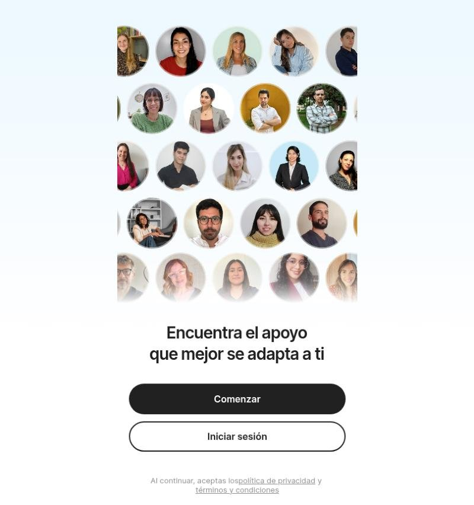
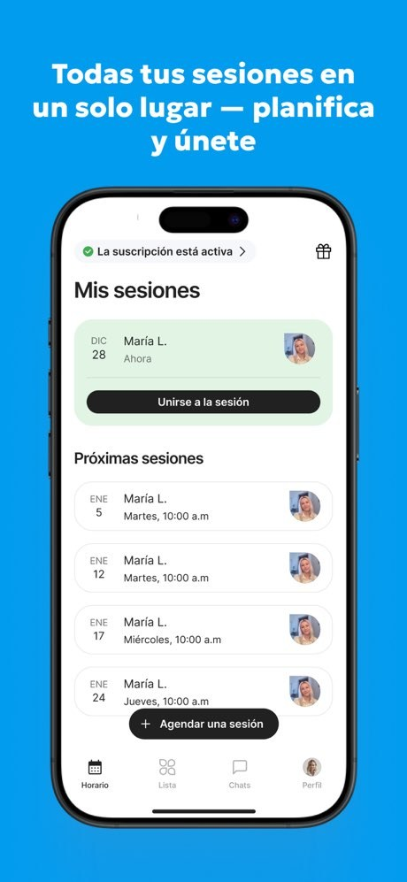
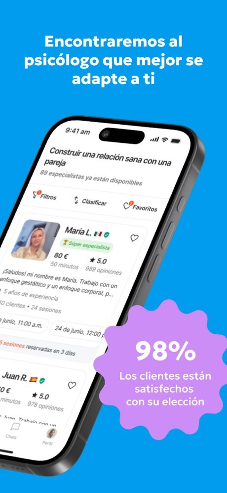
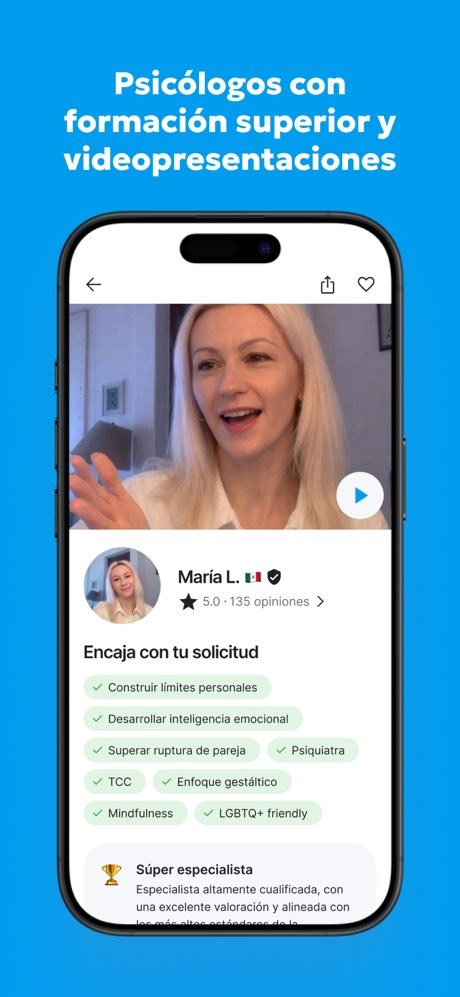
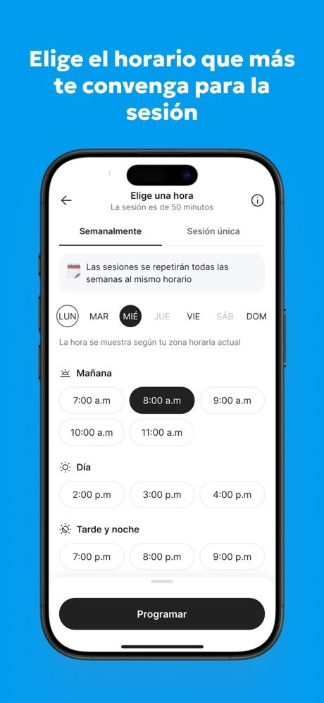
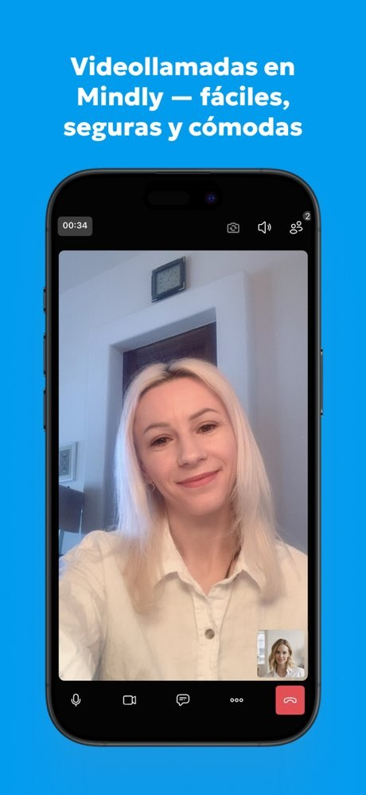
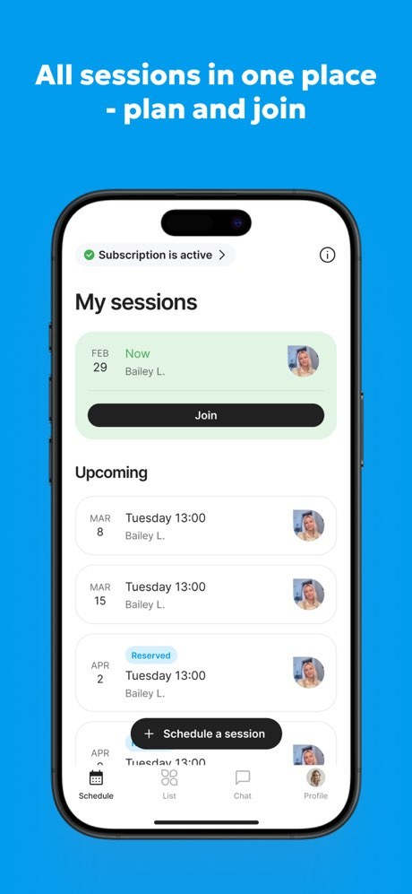

# Benchmark · Mindly: la pantalla principal del paciente

> **Investigado:** 4 de noviembre de 2026
> **Producto:** [Mindly](https://mindlyspace.com/es/), de Mindly Europe OÜ (Tallin, Estonia). Nació en Ucrania y hoy tiene versiones en ucraniano, inglés y castellano. App para iOS y Android, y área web para clientes ([app.mindlyspace.com](https://app.mindlyspace.com/)).
> **Cómo se hizo:** no tenemos una cuenta en Mindly, así que no vimos la app por dentro con sesiones reales. El análisis se basa en las capturas oficiales de la App Store (versión en castellano y en inglés), en la ficha de Google Play (descripción y reseñas), en la landing en castellano y en la pantalla de bienvenida del área web, que es pública. Cuando algo es una inferencia nuestra, lo aclaramos.

---

## 1. Por qué importa para MotivarCare

Mindly es un **competidor directo en el mismo mercado**. Su versión en castellano cobra en dólares ("desde $15 USD/sesión"), las reseñas de su landing son de pacientes latinoamericanos, muestra profesionales de distintos países con su bandera y vende sesiones sueltas o planes "desde 4 sesiones". Es el modelo más parecido al nuestro entre los benchmarks revisados hasta ahora, mucho más que BetterHelp, que funciona con una suscripción semanal en EE. UU.

---

## 2. Resumen

- **La pantalla principal es la agenda.** La primera pestaña se llama **Horario**, y su pantalla se titula **"Mis sesiones"**. Muestra la próxima sesión destacada con el botón "Unirse a la sesión" y, debajo, la lista de "Próximas sesiones". Arriba aparece el estado de la suscripción ("La suscripción está activa").
- **El eje es la sesión, no la relación.** Mientras BetterHelp gira alrededor del terapeuta y la conversación, Mindly gira alrededor del calendario de sesiones. El especialista aparece como dato de cada fila (nombre y foto) y no como título del espacio.
- **Es una pantalla muy funcional, con unos seis componentes:** el indicador de suscripción, un ícono de regalo, el título, la tarjeta de la sesión de ahora, la lista de próximas sesiones con un botón flotante "+ Agendar una sesión" y la barra de pestañas.
- **La navegación tiene cuatro destinos:** Horario · Lista · Chats · Perfil. No incluye herramientas de autocuidado (diario, ánimo, ejercicios): la app se limita a encontrar un especialista, agendar, conversar y hacer la sesión.
- **El tono es directo y transaccional dentro de la app, y más cálido en la landing.** Usa castellano neutro, con algunos rasgos de España ("conoceros", "hablaréis"), y tutea. Las etiquetas de la app son cortas y operativas: "Unirse a la sesión", "Programar", "Agendar una sesión".

---

## 3. Estructura general: la navegación

**Barra de pestañas inferior de cuatro destinos, con ícono y texto siempre visibles** (App Store, 2026):

| Pestaña | Qué contiene |
|---|---|
| **Horario** (en inglés, *Schedule*) | "Mis sesiones": la sesión de ahora y las próximas. **Es la pantalla principal** de quien ya tiene sesiones. |
| **Lista** (*List*) | El catálogo de especialistas filtrado por el motivo de consulta, con filtros, orden y favoritos. |
| **Chats** (*Chat*) | Los mensajes con especialistas. Según Google Play, se les puede escribir **antes de reservar** y entre sesiones. |
| **Perfil** (*Profile*) | La cuenta. El ícono es la foto del usuario. |

**Inferencia sobre la puerta de entrada:** en la captura del catálogo, la pestaña activa es **Lista**. Todo indica que quien todavía no tiene sesiones llega al catálogo de especialistas, y quien ya tiene una agenda llega a **Horario**. El orden de las pestañas (Horario primero) muestra cuál es el uso principal una vez que el paciente ya eligió.

**El área web para clientes** arranca con una bienvenida que se apoya en las personas: un mosaico de fotos de especialistas, el título "Encuentra el apoyo que mejor se adapta a ti" y dos botones, **Comenzar** (relleno) e **Iniciar sesión** (contorno).

| | |
|---|---|
|  |  |
| *Área web para clientes, pantalla de bienvenida pública (captura propia, noviembre de 2026).* | *App Store: "Cuida tu bienestar emocional con Mindly", con 4.7 estrellas y más de 10.000 reseñas.* |

---

## 4. La pantalla principal: "Mis sesiones" (pestaña Horario)

*App Store, versión en castellano: "Mis sesiones" con una sesión en curso y las próximas.*

### 4.1 Componentes, de arriba hacia abajo

| # | Componente | Qué muestra | Comentario |
|---|---|---|---|
| 1 | **Indicador de suscripción** | Una etiqueta con un visto verde: "La suscripción está activa >" | El estado comercial va antes que todo. Es tranquilizador ("todo en orden"), pero pone el plan por delante de la persona. Lleva a la gestión del plan. |
| 2 | **Ícono de regalo** (arriba a la derecha) | Un ícono de regalo. En la versión en inglés, en ese lugar hay un ícono de información (ⓘ). | *Inferencia:* probablemente lleva a un programa de referidos o a regalar sesiones. Es un espacio de crecimiento dentro de la pantalla principal. |
| 3 | **Título** | "Mis sesiones" | Nombra la función y no a la persona ni el momento. No hay un saludo. |
| 4 | **Tarjeta de la sesión actual** | Fondo verde claro, la fecha en bloque ("DIC 28"), el nombre del especialista ("María L."), el estado ("Ahora"), la foto y un botón negro de ancho completo: **"Unirse a la sesión"** | Es el único botón fuerte de la pantalla. En inglés, el estado "Now" aparece en verde. |
| 5 | **Lista "Próximas sesiones"** | Filas con la fecha en bloque ("ENE 5"), el especialista, el día y la hora ("Martes, 10:00 a.m"), la foto y, en algunas, la etiqueta "Reserved" | Las sesiones recurrentes se ven como una serie: el mismo día y la misma hora todas las semanas. Así se hace visible el compromiso con un plan. |
| 6 | **Botón flotante "+ Agendar una sesión"** | Una píldora negra que flota sobre la lista | Es la segunda acción. Siempre está a mano, aunque tapa parte de la lista. |
| 7 | **Barra de pestañas** | Horario · Lista · Chats · Perfil | La pestaña activa está en negro y las demás en gris. |

**En total son unos seis componentes estructurales.** No hay saludo, ni registro del ánimo, ni contenido, ni accesos al chat desde la pantalla principal.

### 4.2 Cómo prioriza la información

1. **El estado de mi plan:** la suscripción activa.
2. **Qué está pasando ahora:** la sesión de "Ahora" y cómo entrar.
3. **Qué viene después:** la lista de las próximas sesiones.
4. **Qué puedo hacer:** agendar otra sesión.

### 4.3 Estados que se ven en las capturas

- **Sesión en curso o a punto de empezar:** la tarjeta verde con "Ahora" y "Unirse a la sesión".
- **Sesiones reservadas a futuro:** filas neutras, algunas con la etiqueta "Reserved" (en azul claro).
- **Sin sesiones:** no hay capturas. *Inferencia:* la persona llega a la pestaña Lista para elegir un especialista.

Según Google Play, la app manda **recordatorios 24 horas, 1 hora y 15 minutos antes** de cada sesión, y avisa cuando llega un mensaje nuevo.

---

## 5. Las otras pantallas, en relación con la principal

### Lista (el catálogo de especialistas)

El encabezado retoma el motivo de consulta del paciente: **"Construir una relación sana con una pareja — 89 especialistas ya están disponibles"**. Debajo hay tres controles: **Filtros**, **Clasificar** y **Favoritos**, este último con un contador. Cada tarjeta muestra la foto, el nombre, la bandera del país, una insignia de verificación, el sello "Súper especialista", el precio y la duración ("80 € · 50 minutos"), la valoración y la cantidad de opiniones ("★ 5.0 · 989 opiniones"), el comienzo de la presentación ("¡Saludos! mi nombre es María…"), los años de experiencia, clientes y sesiones ("5 años de experiencia · 10 clientes · 24 sesiones"), los **próximos horarios libres** ("24 de junio, 11:00 a.m.") y una señal de demanda en rojo ("5 sesiones reservadas en 3 días").

### Perfil del especialista

Arriba tiene un **video de presentación** que se reproduce dentro de la app, con el nombre, la bandera, la verificación y "5.0 · 135 opiniones". Hay un bloque **"Encaja con tu solicitud"** con etiquetas tildadas que cruzan lo que pidió el paciente con lo que ofrece el especialista: "Construir límites personales", "Desarrollar inteligencia emocional", "TCC", "Mindfulness", "LGBTQ+ friendly"… También se explica qué significa el sello "Súper especialista". Al final están el botón del chat y el de reservar.

### Elegir un horario

El título es "Elige una hora", con la aclaración "La sesión es de 50 minutos". Se puede elegir entre **Semanalmente** y **Sesión única**. Hay un aviso: "Las sesiones se repetirán todas las semanas al mismo horario". Para elegir el día hay una fila de días de la semana, con los no disponibles en gris, y la nota **"La hora se muestra según tu zona horaria actual"**. Los horarios se agrupan por franja (**Mañana, Día, Tarde y noche**), con un ícono para cada una, y el botón final es "Programar".

### Videollamada

Es propia, sin servicios externos. La imagen del especialista ocupa toda la pantalla y la del paciente aparece en un recuadro chico. Abajo están los controles: micrófono, cámara, chat, más opciones y colgar (en rojo).

| | | |
|---|---|---|
|  |  |  |
| *Lista: el catálogo filtrado por el motivo de consulta.* | *Perfil: video, "Encaja con tu solicitud" y "Súper especialista".* | *Horario: semanal o única, por franjas, con la zona horaria.* |

| | |
|---|---|
|  |  |
| *Videollamada propia.* | *Versión en inglés: "Subscription is active", "Now", "Join", "Upcoming" y la etiqueta "Reserved".* |

---

## 6. Tono de voz

| Rasgo | Ejemplos |
|---|---|
| **Dentro de la app: etiquetas cortas y operativas** | "Mis sesiones", "Próximas sesiones", "Unirse a la sesión", "Agendar una sesión", "Programar" |
| **Datos prácticos claros** | "La sesión es de 50 minutos", "La hora se muestra según tu zona horaria actual", "Las sesiones se repetirán todas las semanas al mismo horario" |
| **Personaliza a partir de lo que pidió el paciente** | "Construir una relación sana con una pareja", "Encaja con tu solicitud" |
| **Prueba social y urgencia** (más cerca del comercio electrónico) | "5 sesiones reservadas en 3 días", "Súper especialista", "89 especialistas ya están disponibles", "98% Los clientes están satisfechos con su elección" |
| **Landing: cálida y tranquilizadora** | "Tu salud mental está en buenas manos", "Da el primer paso hacia el cambio", "Tu apoyo siempre a tu alcance" |
| **Landing: le baja la exigencia a la primera vez** | "No necesitas ninguna preparación especial. Basta con elegir un lugar cómodo y privado…" |
| **Tratamiento** | Tuteo en castellano neutro con rasgos de España ("conoceros", "hablaréis"). Usa algunos emojis en la landing ("cuando quieras👌"). |

**Conclusión sobre el tono:** es eficiente y comercial. Dentro de la app, casi no hay textos que acompañen: la calidez está en la landing y en las personas (fotos, videos y presentaciones en primera persona), no en los mensajes del sistema. Usa recursos de *marketplace* (insignias, contadores de demanda, porcentajes) que generan confianza, pero también presión.

**Lo visual:** la marca es azul intenso con acentos violetas y verdes en las piezas de la tienda. La app es blanca y neutra, con botones negros en forma de píldora, tarjetas grises muy claras y **un solo color de estado**: el verde claro para la sesión de "Ahora".

---

## 7. Comparación con BetterHelp y con nuestro mockup del Inicio

| Tema | Mindly | BetterHelp | Mockup de MotivarCare (`06-app-usuario/mockups/06-sesion-telefono.png`) | Para pensar |
|---|---|---|---|---|
| **Eje de la pantalla principal** | La agenda ("Mis sesiones") | El vínculo con el terapeuta (la conversación) | El próximo paso del paciente, en un Inicio propio | Nuestro Inicio está en el medio: muestra la sesión (como Mindly) y al profesional con nombre y foto (más cerca de BetterHelp). Es una posición que vale la pena sostener. |
| **Saludo y contexto** | No tiene: el título es "Mis sesiones" | No tiene: el título es "Therapy with Dr. …" | "Miércoles 4 de noviembre — Hola, Gastón." | Somos los únicos que saludamos. Suma calidez sin agregar ruido. |
| **Sesión de ahora** | Una tarjeta verde: "Ahora" y "Unirse a la sesión" | Una franja: "starts in 5 minutes" y "Join video session" | "Empieza en 8 minutos", "Entrar a la sesión" y "Probar cámara" | **Los tres coinciden:** arriba de todo, con un solo botón fuerte. Nuestra cuenta regresiva y "Probar cámara" son más útiles que el genérico "Ahora". |
| **Zona horaria** | "La hora se muestra según tu zona horaria actual" (al reservar) | "PST" junto a cada hora | "hora de Argentina" | **Coincide.** La fórmula de Mindly ("según tu zona horaria actual") sirve para el flujo de reserva. |
| **Estado del plan** | "La suscripción está activa", lo primero de la pantalla | No aparece | "3 sesiones disponibles" y "Reservar", al final | Va bien que lo nuestro esté abajo: primero la persona y después el paquete. Mostrar las sesiones que quedan es más claro que decir "suscripción activa". |
| **Próximas sesiones** | Una lista de toda la serie en la pantalla principal | Fuera de la pantalla principal (en Schedule) | En la pestaña "Sesiones" | Podríamos mostrar "Tu próxima sesión después de esta" con una sola línea, sin la lista completa. |
| **Acción de agendar** | Un botón flotante, siempre visible: "+ Agendar una sesión" | En la pestaña Schedule | "Reservar →", en la tarjeta de sesiones disponibles | El botón flotante tapa contenido. Nuestro acceso en contexto es más calmo. |
| **Autocuidado** (diario, ánimo) | No tiene | Wellness (diario y objetivos) | "¿Cómo estás hoy?" en el Inicio, y la pestaña Diario | Es una diferencia frente a Mindly: nosotros acompañamos entre sesiones. |
| **Navegación** | 4 pestañas: Horario · Lista · Chats · Perfil | 5: Therapy · Wellness · Schedule · Worksheets · More | 5: Inicio · Sesiones · Profesional · Diario · Bienestar | Mindly separa **Chats**. Si mantenemos el chat, falta definir dónde vive. |
| **Elegir profesional** | Un catálogo con filtros, precios, valoraciones, horarios libres y "Encaja con tu solicitud" | Asignación automática y una lista corta si se pide un cambio | Los profesionales sugeridos, con el precio visible (Inicio sin profesional) | "Encaja con tu solicitud" es un patrón muy bueno para explicar **por qué** sugerimos a alguien (está entre los pendientes del README del frente 06). |
| **Reserva recurrente** | "Semanalmente / Sesión única" y "se repetirán todas las semanas al mismo horario" | "Repeats weekly" | No está definido | Vale la pena considerarlo para quien compra paquetes de 4 o más sesiones. |
| **Tono** | Operativo en la app y comercial en las fichas | Cálido y con nombre propio | Voseo amable y calmo | Conviene evitar los recursos de urgencia ("5 sesiones reservadas en 3 días") por el criterio de "calma visual" y de "credibilidad antes que promesa". |

### Ideas que surgen de esta investigación

1. **Explicar por qué sugerimos a cada profesional.** Adaptar "Encaja con tu solicitud": etiquetas que crucen lo que la persona contó con la especialidad del profesional, en el Inicio sin profesional y en la ficha.
2. **Agrupar los horarios por franja (mañana, tarde y noche) e informar la zona horaria** con una frase simple en el paso de reserva.
3. **Ofrecer la reserva recurrente** ("Todas las semanas a esta hora") para los paquetes, con el aviso claro de que se repite.
4. **Mostrar la próxima sesión siguiente en una línea** debajo de la tarjeta principal, sin la lista completa: da continuidad sin sumar peso.
5. **No copiar la presión comercial.** Las insignias de "Súper especialista", los contadores de demanda y el estado de la suscripción arriba de todo contradicen la calma que buscamos. El dato verificable (matrícula, años de experiencia) alcanza.
6. **Avisos antes de la sesión.** Los tres recordatorios de Mindly (24 h, 1 h y 15 min) son una buena referencia para definir los nuestros, cuidando la discreción del texto.

---

## 8. Límites de esta investigación

- No vimos la app con una cuenta real. La pantalla principal sale de las capturas oficiales de la tienda, que muestran un caso ideal, con datos ficticios ("María L.", "Bailey L.").
- No hay capturas del estado vacío (sin sesiones), del chat ni del perfil del paciente.
- En el área web no avanzamos más allá de la bienvenida: para seguir había que responder el cuestionario con datos de salud.
- Las imágenes de la App Store pertenecen a Mindly. La bienvenida web es una captura propia de una página pública. Como el repositorio es público, **conviene decidir antes del push si las imágenes se suben** (el mismo criterio que con BetterHelp).

---

## Fuentes

- [Mindly, landing en castellano](https://mindlyspace.com/es/): propuesta, precios, preguntas frecuentes y tono
- [Mindly, landing principal](https://mindlyspace.com/): versión en ucraniano, cancelación y sistemas propios
- [Mindly Therapy, App Store](https://apps.apple.com/us/app/mindly-therapy/id1599105020): capturas 01 a 07 (versiones en castellano y en inglés)
- [Mindly, Google Play](https://play.google.com/store/apps/details?id=app.mindlyspace.com): funciones, recordatorios, desarrollador y reseñas
- [Mindly, área web para clientes](https://app.mindlyspace.com/): captura 08 (bienvenida)
