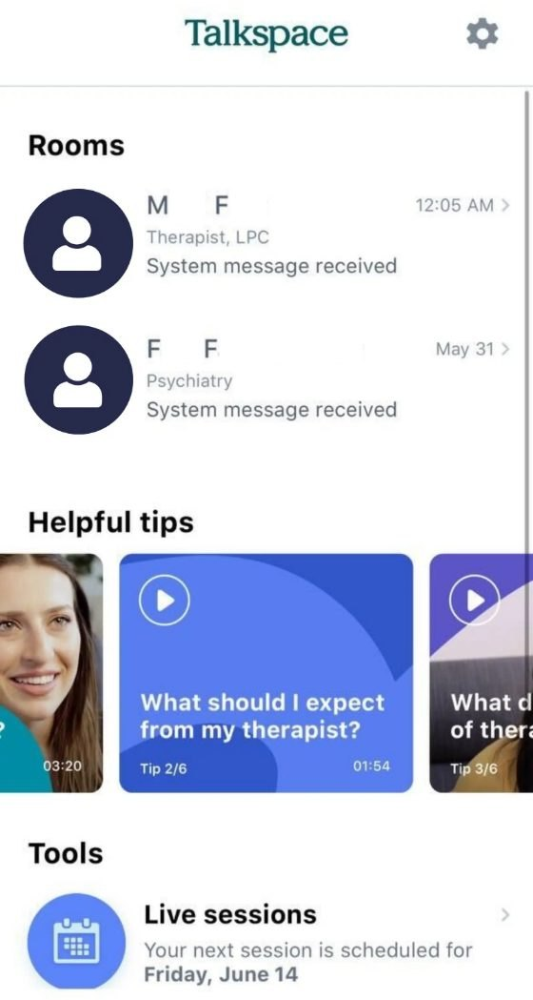
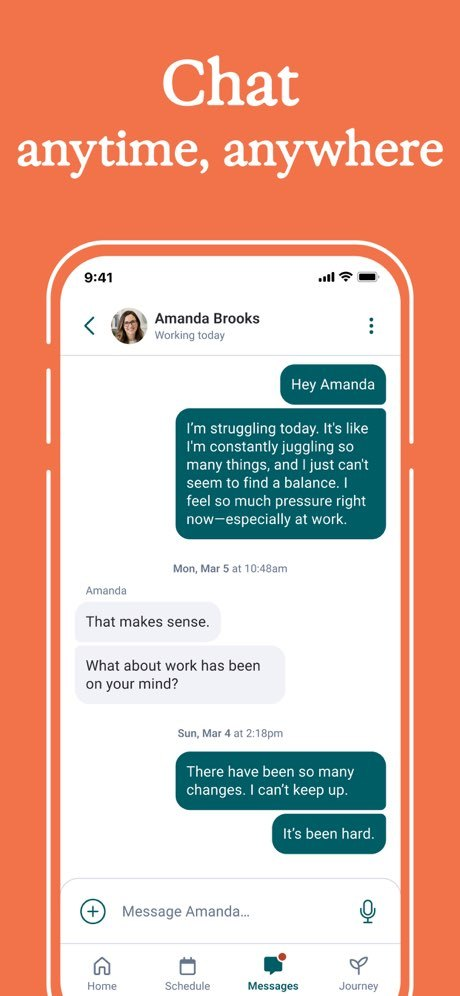
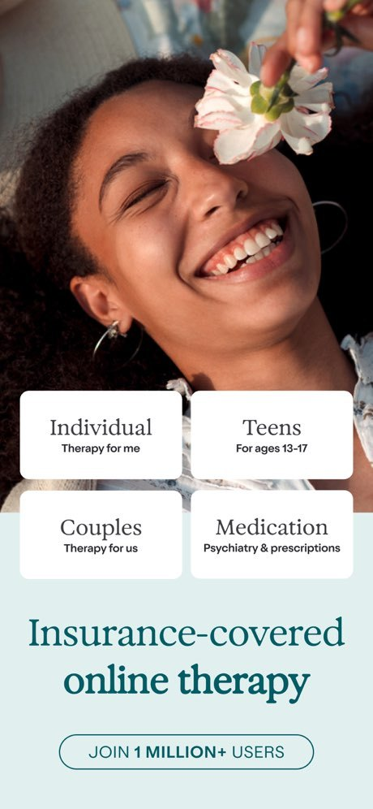
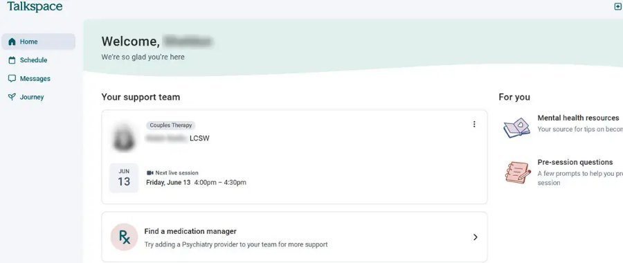
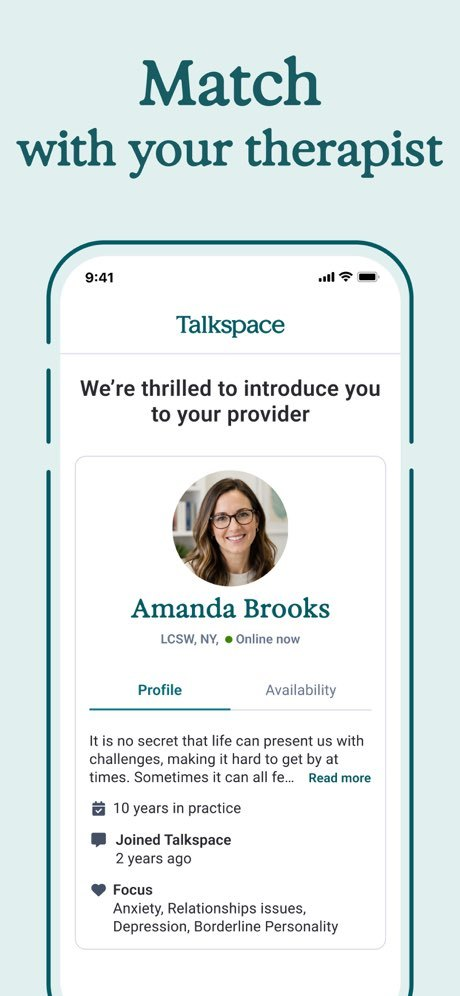
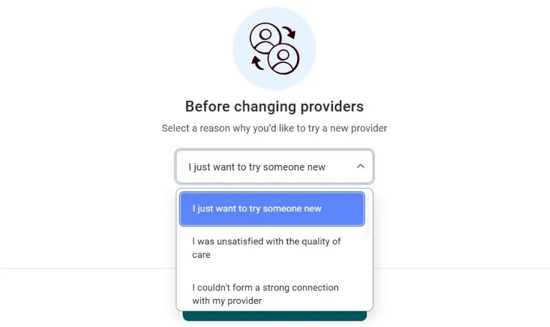
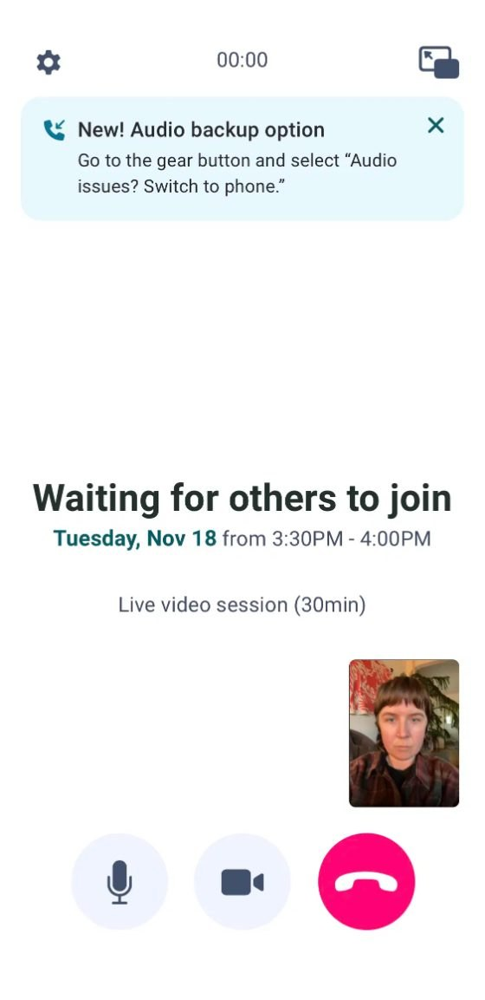
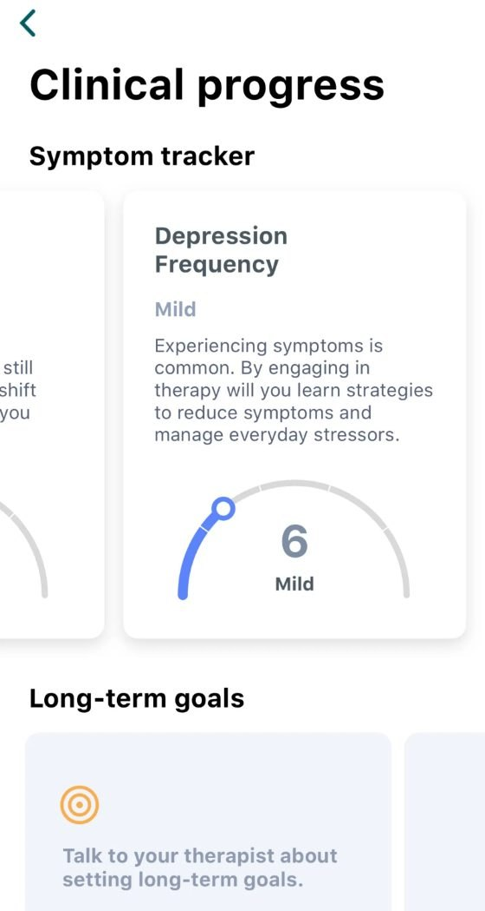
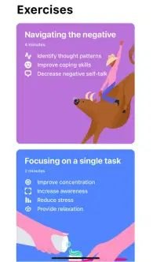

# Benchmark · Talkspace: la pantalla principal del paciente

> **Investigado:** 4 de noviembre de 2026
> **Producto:** [Talkspace](https://www.talkspace.com/), de Groop Internet Platform Inc. (EE. UU.). App para iOS y Android, y versión web. Atiende solo en EE. UU., con cobertura de seguros médicos y empleadores.
> **Cómo se hizo:** no tenemos una cuenta en Talkspace, así que no recorrimos la app con sesiones reales. El análisis se basa en las capturas oficiales de la App Store (2026), en capturas de reseñas que probaron el servicio (HelpGuide, junio de 2025; ChoosingTherapy, 2023 a 2025), en el blog de diseño de Talkspace y en la descripción oficial de la app. Cuando algo es una inferencia nuestra, lo aclaramos.

---

## 1. Resumen

- **Talkspace sí tiene una "Home" de verdad.** Es el único de los benchmarks con un Inicio pensado como tal: un saludo con nombre propio ("Welcome, … — We're so glad you're here"), un bloque **"Your support team"** con los profesionales del paciente y su próxima sesión, y una columna **"For you"** con recursos y preparación para la sesión.
- **El eje es el "equipo de apoyo".** La experiencia se organiza alrededor de las personas que atienden al paciente: terapeuta, psiquiatra y terapeuta de pareja. Cada servicio es una tarjeta, y la Home invita a sumar otros ("Find a medication manager — Try adding a Psychiatry provider to your team").
- **Tiene pocos componentes, unos cinco en la Home:** el saludo, la tarjeta de cada profesional con su próxima sesión, una tarjeta para sumar un servicio, los recursos "For you" y la navegación.
- **La navegación tiene cuatro destinos, con texto:** Home · Schedule · Messages · Journey. Son los mismos en la web (barra lateral) y en el teléfono (barra inferior).
- **El tono es cálido, en segunda persona y con mucha bienvenida.** Por ejemplo: "We're so glad you're here", "We're thrilled to introduce you to your provider", "Space to figure things out". En los temas clínicos, normaliza sin alarmar: "Experiencing symptoms is common."

---

## 2. Cómo evolucionó la pantalla principal

| Versión | Pantalla principal | Fuente |
|---|---|---|
| **Hasta 2023:** "Rooms" | El logo y un ícono de ajustes arriba. Una lista de **"Rooms"**, una sala por profesional (por ejemplo, terapeuta LPC y psiquiatría), con el último mensaje ("System message received") y la hora. Debajo, **"Helpful tips"**: un carrusel de videos cortos ("What should I expect from my therapist? · Tip 2/6 · 01:54"). Al final, **"Tools"**: "Live sessions — Your next session is scheduled for Friday, June 14" | ChoosingTherapy, 2023 |
| **2025-2026:** "Home" | El saludo con nombre, "Your support team" (una tarjeta por profesional con su próxima sesión), la invitación a sumar psiquiatría y "For you" (recursos y preguntas para antes de la sesión). La navegación es Home · Schedule · Messages · Journey | HelpGuide (junio de 2025) y App Store (2026) |

**Qué cambió:** pasaron de un modelo de **salas de chat** (al estilo de una app de mensajería, coherente con su origen de "terapia por texto") a un **Inicio con un equipo de profesionales y sesiones**. Los mensajes quedaron en su propia pestaña, y el contenido pasó de un carrusel de videos a una columna corta de dos recursos.

*Versión anterior (2023): Rooms, Helpful tips y Tools. Captura de ChoosingTherapy.*

---

## 3. Estructura general: la navegación

**Hay cuatro destinos, con ícono y texto siempre visibles.** En la web están en una barra lateral izquierda y en el teléfono en la barra inferior:

| Destino | Qué contiene |
|---|---|
| **Home** (inicio) | El saludo, "Your support team" y "For you". |
| **Schedule** (agenda) | Las sesiones en vivo, para reservar y gestionar. |
| **Messages** (mensajes) | Una conversación por profesional, con mensajes ilimitados de texto, audio, foto o video. El terapeuta responde "al menos una vez por día, 5 días a la semana" (App Store). |
| **Journey** (recorrido, con un ícono de brote) | *Inferencia:* el progreso del paciente. Por las capturas, incluye el **"Clinical progress"** (seguimiento de síntomas como "Depression Frequency: 6 · Mild", con una explicación que normaliza), los **"Long-term goals"** y los **ejercicios** ("Navigating the negative", "Focusing on a single task"). También están los **Talkcasts**, pódcasts personalizados que se generan con IA a partir de un guion que revisa el terapeuta (App Store). |

La cuenta, los pagos y el cambio de profesional quedan en ajustes (el ícono de engranaje o el menú de la cuenta).

| | |
|---|---|
|  |  |
| *App Store, 2026: la pestaña Messages activa, con la barra Home · Schedule · Messages · Journey.* | *App Store: los servicios (Individual, Teens, Couples, Medication).* |

---

## 4. La pantalla principal: "Home"

*Home en la web, junio de 2025. Captura de HelpGuide, que difuminó el nombre del usuario y del terapeuta.*

### 4.1 Componentes, de arriba hacia abajo

| # | Componente | Qué muestra | Comentario |
|---|---|---|---|
| 1 | **Saludo** | Una franja ondulada en verde agua: **"Welcome, [nombre]"** y debajo **"We're so glad you're here"** | Es el único benchmark que saluda, igual que nuestro mockup. La forma ondulada le saca rigidez. |
| 2 | **"Your support team"** (una tarjeta por profesional) | La foto, una etiqueta con el servicio ("Couples Therapy"), el nombre y el título ("LCSW"), un menú (⋮) y, en un bloque interno, la **fecha en bloque** ("JUN 13"), un ícono de video y "Next live session — Friday, June 13 · 4:00pm – 4:30pm" | El profesional y su próxima sesión van **juntos en la misma tarjeta**. La etiqueta del servicio sirve cuando hay más de uno (terapia, pareja, psiquiatría). |
| 3 | **Tarjeta para sumar un servicio** | Un ícono "Rx" y el texto **"Find a medication manager — Try adding a Psychiatry provider to your team for more support"**, con una flecha | Es la única pieza comercial, y está escrita como cuidado ("for more support"). Se integra al "equipo" en lugar de ser un anuncio. |
| 4 | **"For you"** (columna derecha) | **"Mental health resources — Your source for tips on becoming…"** y **"Pre-session questions — A few prompts to help you prepare for your session"**, cada uno con una ilustración chica | Hay solo dos recursos, con ilustraciones a línea. Las **preguntas para antes de la sesión** son un recurso clínico útil, no contenido de relleno. |
| 5 | **Navegación** | Home · Schedule · Messages · Journey | En la web, una barra lateral con texto. |

**En total son unos cinco componentes estructurales.** No hay un botón principal grande cuando no hay una sesión inminente: la pantalla informa y ordena. *Inferencia:* cuando la sesión está por empezar, se entra desde un aviso o desde la agenda. La sala de espera de la videollamada dice "Waiting for others to join — Tuesday, Nov 18 from 3:30PM – 4:00PM · Live video session (30min)".

### 4.2 Cómo prioriza la información

1. **Te recibimos:** el saludo con nombre.
2. **Quién te acompaña:** el equipo de apoyo, con nombre, título y servicio.
3. **Cuándo los ves:** la próxima sesión dentro de cada tarjeta.
4. **Qué más podés sumar:** otro servicio.
5. **Cómo prepararte:** las preguntas antes de la sesión y los recursos.

### 4.3 Otros estados y pantallas

- **Presentación del profesional después del emparejamiento:** "We're thrilled to introduce you to your provider". La pantalla muestra la foto, el nombre, el título y el estado ("LCSW, NY · Online now"), dos pestañas (Profile y Availability), la presentación del profesional, "10 years in practice", "Joined Talkspace 2 years ago" y "Focus: Anxiety, Relationships issues, Depression…".
- **Chat:** el nombre del profesional y su estado ("Working today"), burbujas en verde petróleo y gris, fechas como separadores y "Message Amanda…" con un micrófono para audio.
- **Cambio de profesional:** "Before changing providers — Select a reason why you'd like to try a new provider", con una lista de motivos ("I just want to try someone new", "I couldn't form a strong connection with my provider"…). Pide un motivo pero no culpa.
- **Videollamada:** "Waiting for others to join", con un aviso útil: "New! Audio backup option — Go to the gear button and select 'Audio issues? Switch to phone.'"

| | | |
|---|---|---|
|  |  |  |
| *"We're thrilled to introduce you to your provider." App Store.* | *"Before changing providers", con motivos para elegir. HelpGuide, 2025.* | *Sala de espera de la videollamada y alternativa de audio por teléfono. ChoosingTherapy, 2025.* |

| | |
|---|---|
|  |  |
| *"Clinical progress": seguimiento de síntomas con un texto que normaliza y objetivos de largo plazo. ChoosingTherapy, 2024.* | *"Exercises": ejercicios cortos con duración y beneficios. ChoosingTherapy, 2023.* |

---

## 5. Tono de voz

| Rasgo | Ejemplos |
|---|---|
| **Bienvenida explícita y cálida** | "We're so glad you're here", "We're thrilled to introduce you to your provider" |
| **El paciente acompañado por un equipo** | "Your support team", "Try adding a Psychiatry provider to your team for more support" |
| **Normaliza sin alarmar** | "Experiencing symptoms is common. By engaging in therapy you will learn strategies…" |
| **Devuelve la decisión al vínculo con el terapeuta** | "Talk to your therapist about setting long-term goals." |
| **Prepara para la sesión** | "A few prompts to help you prepare for your session" |
| **Ofrece una alternativa práctica ante un problema** | "Audio issues? Switch to phone." |
| **Marca con frases cortas y humanas** | "Space to figure things out", "Chat anytime, anywhere", "No long waits." |

**Conclusión sobre el tono:** es el más **contenedor** de los cuatro benchmarks. Recibe a la persona, la ubica dentro de un equipo, le explica lo clínico con calma y siempre la devuelve al terapeuta. El blog de diseño de Talkspace explicita el criterio: innovar en el acceso, no en la interfaz, y usar patrones conocidos para que la persona "se concentre en trabajar con su terapeuta".

**Lo visual:** el verde petróleo es el color principal. Usa una serif para los títulos de marca ("Match with your therapist") y una sans para la interfaz. Hay ilustraciones a línea con toques de color (rosa, verde y celeste), fondos claros en verde agua y el naranja como acento en las piezas de la tienda. Es una estética muy cercana a la de nuestro design system: crema y verdes, con una serif en los títulos.

---

## 6. Comparación con los otros benchmarks y con nuestro mockup

| Tema | Talkspace | BetterHelp | Mindly | Clearly | Mockup de MotivarCare | Para pensar |
|---|---|---|---|---|---|---|
| **Eje** | El equipo de apoyo | El vínculo con un terapeuta (chat) | La agenda | Los terapeutas (tarjetas) | El próximo paso | Talkspace es el más parecido a nosotros: un Inicio propio con saludo, el profesional y la sesión. |
| **Saludo** | "Welcome, … — We're so glad you're here" | No | No | No | "Hola, Gastón." | **Coincide.** Podríamos sumar una segunda línea cálida, como hace Talkspace. |
| **Profesional y sesión** | En la misma tarjeta, con la etiqueta del servicio | Separados (título y aviso) | Fila de la agenda | En la misma tarjeta | En la misma tarjeta (la sesión con la profesional adentro) | **Coincide** con Talkspace y Clearly. La etiqueta del servicio sirve si en el futuro hay psiquiatría o terapia de pareja. |
| **Preparación para la sesión** | "Pre-session questions" | Un texto en la tarjeta del sistema | No | Solo en las preguntas frecuentes | "Probar cámara" | Sumar **preguntas para antes de la sesión**. Se conecta con el Diario: "¿Qué te gustaría contarle hoy a la Lic. Quiroga?" |
| **Contenido** | Dos recursos en "For you" | Wellness, aparte | No | No | "¿Cómo estás hoy?" | Hay que mantenerlo corto: Talkspace pasó de un carrusel a dos tarjetas, lo que confirma lo que decidimos en el caso 03 (sacar el carrusel). |
| **Navegación** | 4: Home · Schedule · Messages · Journey | 5 | 4 | No se ve | 5: Inicio · Sesiones · Profesional · Diario · Bienestar | Talkspace junta el progreso, los objetivos y los ejercicios en **Journey**. Es un argumento para revisar si "Diario" y "Bienestar" pueden unirse. |
| **Progreso** | "Clinical progress": síntomas y objetivos | Goals (1 a 10) | No | No | Un gráfico de la semana (Diario) | La forma de explicar un resultado ("Mild — Experiencing symptoms is common…") es un buen modelo si mostramos evolución. |
| **Ofrecer otro servicio** | "Find a medication manager", como cuidado | No | Un ícono de regalo | Tarjeta regalo (web) | No | Si se ofrecen otros servicios, escribirlos como cuidado y no como venta. |
| **Cambio de profesional** | Con motivos para elegir y sin culpa | En More | No se ve | Un "garantizado" en la web | "Pedir un cambio de profesional", que hace el equipo | La lista de motivos es un buen patrón para el formulario del pedido, junto con el aviso del saldo que se pierde. |
| **Problemas técnicos** | "Audio issues? Switch to phone." | No | No | No | "Probar cámara" | Sumar un plan B visible en la sala: "¿Problemas con el audio? Te llamamos." |

### Ideas que surgen de esta investigación

1. **Agregar una segunda línea de bienvenida al saludo** ("Qué bueno que estés acá"), solo en algunos momentos para no volverla automática: por ejemplo, la primera vez o al volver después de varios días.
2. **Sumar "Preparate para tu sesión"** en la tarjeta de la sesión: dos o tres preguntas para pensar antes, que se pueden guardar en el Diario y compartir con la profesional si la persona quiere.
3. **Usar la etiqueta del servicio en la tarjeta del profesional** ("Terapia individual", "Terapia de pareja"), por si MotivarCare suma otros servicios.
4. **Explicar los resultados con calma.** Si mostramos la evolución del ánimo, acompañarla con una frase que normalice y que devuelva al vínculo ("Podés conversarlo con tu profesional").
5. **Tener un plan B técnico en la sala de espera** ("¿Problemas con el audio?"), además de "Probar cámara".
6. **Revisar la navegación:** evaluar si Diario y Bienestar se agrupan en un solo destino (como Journey), para dejar lugar a Mensajes, como en la variante B del mockup.

---

## 7. Límites de esta investigación

- No vimos la app con una cuenta real. La Home de 2025 es la versión web: no conseguimos una captura de la Home del teléfono en 2026, solo de la barra de pestañas, en la pantalla del chat.
- No está confirmado el contenido exacto de **Journey**: lo inferimos por el ícono y por las capturas de progreso, objetivos y ejercicios.
- Las capturas de 2023 y 2024 son de una versión anterior y sirven para ver la evolución.
- Las imágenes pertenecen a Talkspace y a los medios citados. Como el repositorio es público, **conviene decidir antes del push si las imágenes se suben** (el mismo criterio que con los otros benchmarks).

---

## Fuentes

- [Talkspace, App Store](https://apps.apple.com/us/app/talkspace-therapy-counseling/id661829386): capturas 01, 02 y 03; descripción, Talkcast y tiempos de respuesta
- [HelpGuide, Talkspace Review 2026](https://www.helpguide.org/mental-health/treatment/talkspace-review): capturas 04 y 05 (Home y cambio de profesional, junio de 2025)
- [ChoosingTherapy, Talkspace Review 2026](https://www.choosingtherapy.com/talkspace-review/): capturas 06 a 09 (Rooms 2023, ejercicios, progreso clínico y sala de video)
- [Talkspace, The Psychology of Talkspace's New Design](https://www.talkspace.com/blog/psychology-talkspaces-new-design/): criterios de diseño
