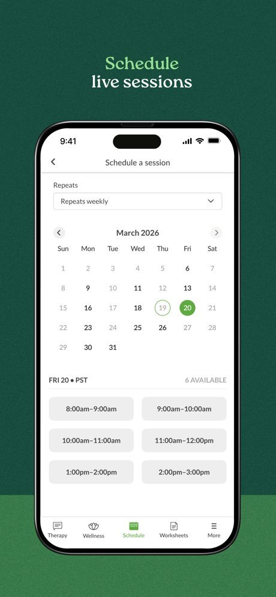
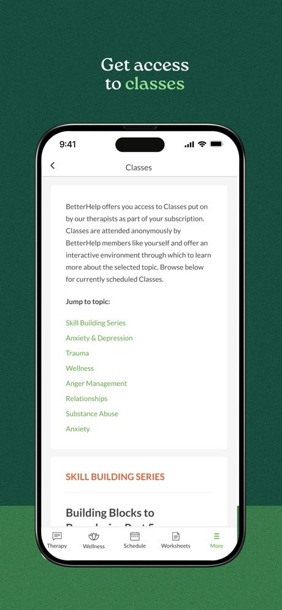
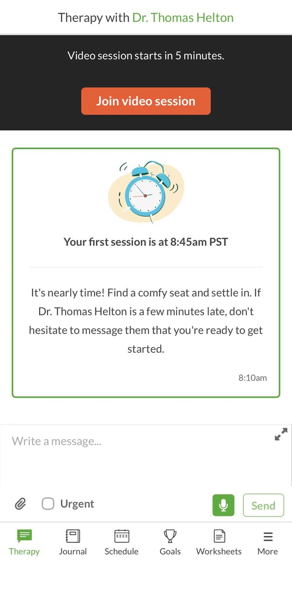
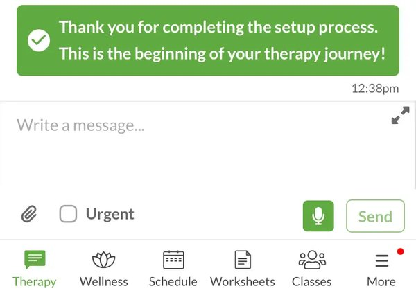
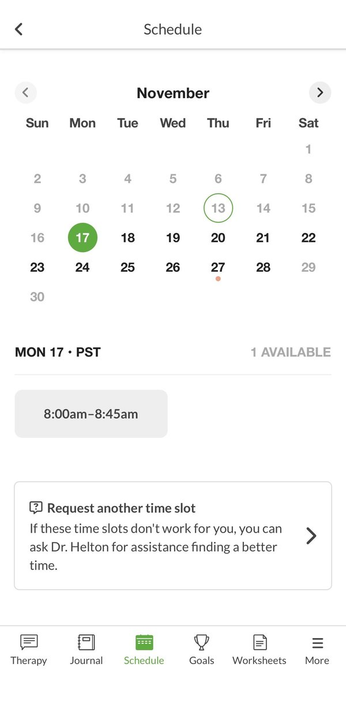
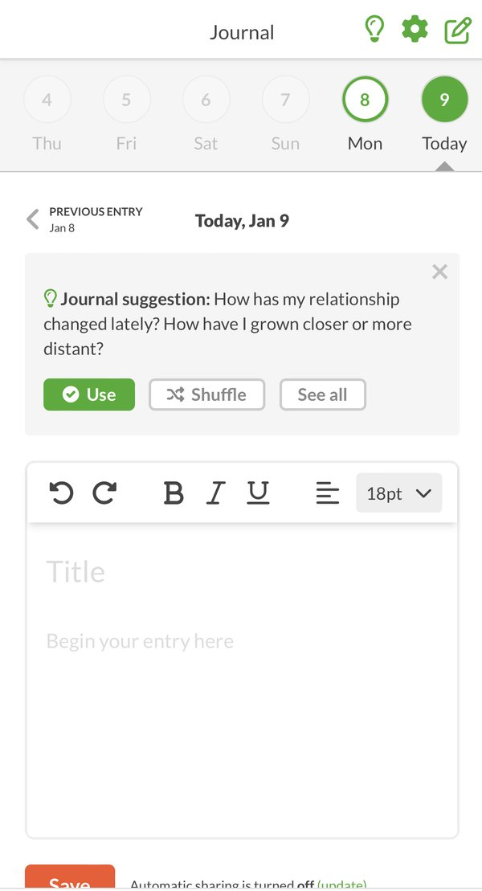
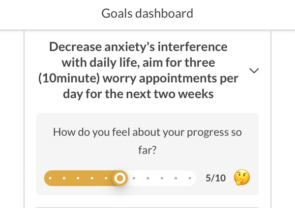
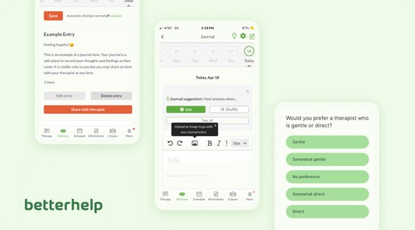
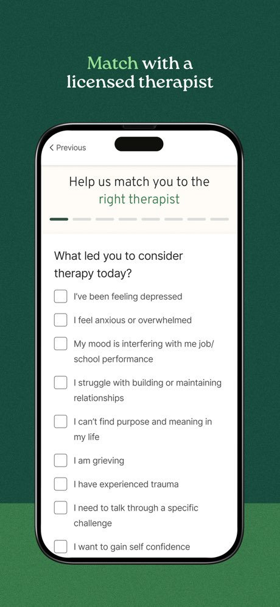

# Benchmark · BetterHelp: la pantalla principal del paciente

> **Investigado:** 4 de noviembre de 2026
> **Producto:** [BetterHelp](https://www.betterhelp.com/), de Teladoc Health. App para iOS y Android, y versión web.
> **Cómo se hizo:** BetterHelp no muestra su app sin una cuenta paga, así que no la recorrimos con una cuenta propia. El análisis se basa en las capturas oficiales de la App Store (septiembre de 2026), en capturas de reseñas que probaron el servicio (ChoosingTherapy, HelpGuide) y en descripciones de la versión web (Forbes Health, Innerbody, Healthline). Cada afirmación indica de dónde sale. Cuando algo es una inferencia nuestra, lo aclaramos.

---

## 1. Resumen

- **BetterHelp no tiene una "Home" en el sentido de un tablero con resumen.** Cuando el paciente abre la app, llega a la pestaña **Therapy**: la conversación con su terapeuta, titulada "Therapy with Dr. …". La pantalla principal es el vínculo con la persona, no un panel de datos.
- **El eje de la experiencia es la relación con el terapeuta.** Todo gira alrededor de una persona con nombre: la sesión, los mensajes, la agenda ("pedile a Dr. Helton otro horario") y los ejercicios que él o ella asigna. Las herramientas de autocuidado (diario, objetivos, clases) son satélites de ese vínculo y se pueden compartir con el terapeuta.
- **La pantalla principal tiene pocos componentes, unos cinco.** Un encabezado con el nombre del terapeuta, un aviso fijo con el estado de la sesión, el hilo de mensajes (con tarjetas del sistema intercaladas), el campo para escribir y la barra de pestañas.
- **El estado cambia según el momento, sin cambiar la estructura.** Cuando falta poco para la sesión, aparece arriba una franja oscura con "Video session starts in 5 minutes." y un único botón naranja, "Join video session".
- **El tono es cálido, en segunda persona, simple y que acompaña.** Por ejemplo: "It's nearly time! Find a comfy seat and settle in." También le da permiso al paciente para actuar: "don't hesitate to message them…".

---

## 2. Estructura general: la navegación

La app se organiza con una **barra de pestañas inferior de cinco o seis destinos, con ícono y texto siempre visibles**. La primera pestaña, la que se abre por defecto, siempre es **Therapy**.

La composición cambió con el tiempo, y en 2025 convivieron variantes (posiblemente pruebas A/B o versiones por región):

| Fuente y fecha | Pestañas |
|---|---|
| ChoosingTherapy, capturas de noviembre y diciembre de 2025 | Therapy · Journal · Schedule · Goals · Worksheets · More |
| HelpGuide, capturas de abril de 2025 | Therapy · Wellness · Schedule · Worksheets · Classes · More |
| App Store oficial, septiembre de 2026 | **Therapy · Wellness · Schedule · Worksheets · More** |

**Cómo evolucionó:** el diario (*Journal*) y los objetivos (*Goals*) pasaron a agruparse en **Wellness** (bienestar), y las clases (*Classes*) quedaron dentro de **More**. Hoy la navegación tiene cinco destinos, con dos bloques claros:

1. **Lo clínico, con el terapeuta:** Therapy (conversación y sesión), Schedule (agenda) y Worksheets (ejercicios que asigna el terapeuta).
2. **El autocuidado:** Wellness (diario, objetivos y seguimiento).
3. **Todo lo demás en More:** cuenta, pagos, cambio de terapeuta, clases y grupos.

En la versión web, según Forbes Health, el tablero muestra a la izquierda **el nombre, la foto y las credenciales del terapeuta**, con un botón debajo para cambiarlo. También se ven los mensajes, un calendario para reservar ("bastante limitado", según la reseña) y una sección de ejercicios donde aparecen los *Wellness Snapshots* (cuestionarios de síntomas previos a la sesión). Innerbody llama a la pantalla central "the Counseling tab's main window" y ubica el calendario de disponibilidad "en tu sala de terapia". Es decir, en la web también el centro es la conversación con el terapeuta.

| | |
|---|---|
|  |  |
| *App Store, 2026: agenda con las pestañas Therapy · Wellness · Schedule · Worksheets · More.* | *App Store, 2026: Classes ya aparece dentro de "More".* |

---

## 3. La pantalla principal: pestaña "Therapy"

*Pestaña Therapy, cinco minutos antes de la primera sesión. Captura de ChoosingTherapy, 2025.*

### 3.1 Componentes, de arriba hacia abajo

| # | Componente | Qué muestra | Comentario |
|---|---|---|---|
| 1 | **Encabezado con el nombre del terapeuta** | "Therapy with **Dr. Thomas Helton**", con el nombre en verde | La pantalla se titula con la persona y no con la función. Desde el primer momento queda claro de quién es este espacio. |
| 2 | **Aviso de estado de la sesión** (aparece según el momento) | Franja oscura de ancho completo: "Video session starts in 5 minutes." y el botón naranja "Join video session" | Es el único llamado a la acción fuerte de la pantalla, y está arriba de todo. ChoosingTherapy confirma que se entra a la sesión con ese botón "en la parte superior de la pantalla". |
| 3 | **Hilo de mensajes con tarjetas del sistema** | Tarjeta con borde verde, ilustración de un reloj, "Your first session is at 8:45am PST" y un texto que acompaña. Hora del mensaje: 8:10am | Los avisos del sistema viven dentro de la conversación, como un mensaje más, con su hora. La zona horaria se indica explícitamente (PST). |
| 4 | **Campo para escribir** | "Write a message...", un botón para ampliar, adjuntar (clip), la casilla **Urgent**, un micrófono (mensaje de voz) y el botón **Send** | La casilla "Urgent" le permite al paciente marcar la prioridad sin salir del flujo. |
| 5 | **Barra de pestañas** | Cinco o seis destinos, con ícono y texto | La pestaña activa se marca en verde. |

**En total son cinco componentes estructurales**, y dentro del hilo aparecen mensajes y tarjetas del sistema. No hay carruseles, ni accesos rápidos, ni métricas, ni promociones en la pantalla principal.

### 3.2 Estados de la pantalla

La estructura siempre es la misma: lo que cambia es el contenido del aviso y de las tarjetas del hilo.

- **Al terminar la configuración:** una tarjeta verde llena con un ícono de visto bueno dice "Thank you for completing the setup process. This is the beginning of your therapy journey!" *(HelpGuide, abril de 2025).*
- **Cuando la sesión está cerca:** el aviso oscuro con el botón para entrar y la tarjeta de recordatorio con la hora y una recomendación *(ChoosingTherapy, 2025).*
- **Entre sesiones:** el hilo de mensajes asincrónicos. El terapeuta suele responder dentro de las 24 horas hábiles, según ChoosingTherapy.

*Tarjeta del sistema al terminar la configuración. Barra de pestañas con Wellness y Classes. HelpGuide, 2025.*

### 3.3 Cómo prioriza la información

1. **Qué está pasando ahora:** la sesión que empieza y cómo entrar.
2. **Con quién:** el terapeuta, con su nombre en el título.
3. **Qué tengo que saber:** la tarjeta con la hora, la zona horaria y qué hacer si el terapeuta se demora.
4. **Qué puedo hacer yo:** escribirle, adjuntar algo o marcar el mensaje como urgente.

---

## 4. Las otras pestañas, en relación con la principal

### Schedule (agenda)

Tiene un calendario mensual, la lista de horarios libres del día ("MON 17 · PST — 1 AVAILABLE"), un selector de repetición ("Repeats weekly") y, al final, una tarjeta para pedir otro horario: **"Request another time slot — If these time slots don't work for you, you can ask Dr. Helton for assistance finding a better time."**

Hasta la agenda se resuelve a través del terapeuta: si no hay un horario que sirva, la salida es pedírselo a esa persona.

| | |
|---|---|
|  |  |
| *Schedule: calendario, horario disponible y "Request another time slot". ChoosingTherapy, 2025.* | *Journal: días como círculos, sugerencia de escritura con "Use / Shuffle / See all" y editor. ChoosingTherapy.* |

### Wellness (bienestar): diario y objetivos

- **Diario (Journal):** una tira de días arriba, con el día actual marcado como "Today". Muestra una sugerencia de escritura que se puede **usar, cambiar por otra (Shuffle) o ver todas**, un editor con formato y el botón "Save". Abajo indica: "Automatic sharing is turned off (update)". **Por defecto es privado** y compartir con el terapeuta es una decisión explícita, con un botón "Share with therapist" en cada entrada. Además, la app manda un recordatorio diario para escribir (Top10).
- **Objetivos (Goals dashboard):** objetivos concretos y medibles, que se pueden elegir por categoría ("managing difficult emotions", "self-care & compassion", "physical health") o escribir desde cero. Se dividen en pasos y **se comparten automáticamente con el terapeuta** (ChoosingTherapy). Cada objetivo pregunta "How do you feel about your progress so far?" y se responde con una escala de 1 a 10 y un emoji.

| | |
|---|---|
|  |  |
| *Goals dashboard: objetivo concreto y escala de progreso de 1 a 10. HelpGuide, 2025.* | *Material de BetterHelp: el diario aparece con la pestaña "Wellness" activa, lo que confirma que el diario vive ahí.* |

### Worksheets (ejercicios)

Más de 150 hojas de trabajo digitales que asigna el terapeuta o que el paciente completa por su cuenta (SUNY Geneseo). En la web, en esta sección también aparecen los *Wellness Snapshots* (Forbes Health).

### More (más)

Cuenta, pagos, cambio de terapeuta, clases (*Classes*) y grupos (*Groupinars*). Para cancelar: "Menu > My Account > Payment Settings > Quit therapy" (Healthline).

---

## 5. Cómo empieza la relación: el matching

Antes de llegar a la pantalla principal, el paciente completa un cuestionario en pasos, con una barra de progreso: "Help us match you to the right therapist". La primera pregunta es "What led you to consider therapy today?", con respuestas para marcar escritas en primera persona ("I feel anxious or overwhelmed", "I am grieving"…). Otra pregunta es "Would you prefer a therapist who is gentle or direct?", con cinco opciones que van de *Gentle* a *Direct*.

Ese cuestionario termina en una persona asignada, y desde ahí todo se ordena alrededor de ella.

*App Store, 2026: primera pregunta del matching.*

---

## 6. Tono de voz

| Rasgo | Ejemplos (textos de la interfaz, en inglés) |
|---|---|
| **Segunda persona, cercano y con un toque informal** | "It's nearly time! Find a comfy seat and settle in." |
| **Le da permiso al paciente y le baja la ansiedad** | "…don't hesitate to message them that you're ready to get started." |
| **Celebra los hitos y habla de un camino** | "This is the beginning of your therapy journey!" |
| **Ofrece una salida en lugar de un error** | "If these time slots don't work for you, you can ask Dr. Helton for assistance…" |
| **Usa la primera persona del paciente para que se identifique** | "I feel anxious or overwhelmed", "I can't find purpose and meaning in my life" |
| **Cuenta los datos prácticos sin dramatizar** | "Your first session is at 8:45am PST", "Automatic sharing is turned off" |
| **Hace preguntas reflexivas en lugar de dar órdenes** | "How do you feel about your progress so far?", "How has my relationship changed lately?" |

**Conclusión sobre el tono:** es cálido y práctico. Siempre nombra al terapeuta por su nombre, usa frases cortas, celebra los avances de a poco y no recurre a un lenguaje clínico ni alarmista. Los signos de exclamación quedan reservados para los hitos.

**Lo visual acompaña ese tono:** verde como color de marca (y como estado activo), ilustraciones amables en las tarjetas del sistema (el reloj) y un único color de acento cálido (naranja) para las acciones decisivas: "Join video session", "Save" y "Share with therapist". Las críticas que aparecen en las reseñas apuntan a cosas fuera de la pantalla principal: la cantidad de notificaciones y que los recordatorios por SMS mencionan la palabra "therapy" (Healthline).

---

## 7. Comparación con nuestro mockup del Inicio

| Tema | BetterHelp | Mockup de MotivarCare (`mockups/06-sesion-telefono.png`) | Para pensar |
|---|---|---|---|
| **Eje de la pantalla principal** | La conversación con el terapeuta (pestaña "Therapy") | Un Inicio propio con el próximo paso del paciente | Nuestro Inicio es un "tablero calmo". Podríamos reforzar la presencia del profesional, por ejemplo con el nombre y un acceso a escribirle, si el equipo decide mantener el chat (está entre los pendientes del README). |
| **Estado de la sesión** | Franja fija arriba con un solo botón: "Join video session" | Tarjeta principal: "Empieza en 8 minutos", "Entrar a la sesión", "Probar cámara" | **Coincide.** Las dos soluciones ponen arriba lo que pasa ahora, con un único llamado a la acción fuerte. Nuestro "Probar cámara" suma algo que BetterHelp no tiene en esa pantalla. |
| **Recomendación antes de la sesión** | "Find a comfy seat and settle in" y qué hacer si el terapeuta se demora | No aparece | Podríamos sumar una línea de acompañamiento, en voseo: "Buscá un lugar tranquilo. Si la Lic. Quiroga se demora, escribile." |
| **Zona horaria** | "8:45am PST", "MON 17 · PST" | "hora de Argentina" | **Coincide.** Es importante para la reserva entre países (una de las heurísticas de la auditoría). |
| **Cantidad de componentes** | Unos 5 | Unos 5 (saludo, sesión, ánimo, sesiones disponibles, navegación) | Es una densidad parecida. |
| **Navegación** | 5 pestañas con texto: Therapy · Wellness · Schedule · Worksheets · More | 5 pestañas con texto: Inicio · Sesiones · Profesional · Diario · Bienestar | BetterHelp agrupó el diario y los objetivos en "Wellness". Hay que evaluar si "Diario" y "Bienestar" se mantienen separados o se unen. |
| **Privacidad del diario** | Privado por defecto; "Automatic sharing is turned off" y "Share with therapist" explícito | "Solo lo ves vos, salvo que elijas compartirlo" | **Coincide**, y confirma la decisión del caso 05 (H1). |
| **Registro del ánimo** | Dentro de Wellness, con escalas de 1 a 10 en los objetivos | En el Inicio: "¿Cómo estás hoy?", con cinco opciones | Nosotros lo pusimos más a mano. BetterHelp no pregunta el ánimo en su pantalla principal. |
| **Paquete o sesiones disponibles** | No aparece en la pantalla principal (es una suscripción semanal) | "3 sesiones disponibles" y "Reservar" | Es una diferencia del modelo de negocio: tiene sentido en MotivarCare, sin suscripción. |
| **Agenda sin horarios** | "Request another time slot", que se le pide al terapeuta | No está definido | Es un patrón para copiar en el flujo de reserva cuando no hay horarios que sirvan. |
| **Mensajes del sistema** | Viven dentro del hilo del chat, con su hora | Campana de notificaciones | Si no se mantiene el chat, la campana es el lugar natural para esos avisos. |
| **Cambio de profesional** | En el panel del terapeuta (web) y en More (app), siempre disponible | "Pedir un cambio de profesional": lo hace el equipo de MotivarCare, a pedido | Nuestra regla es más cuidada (avisa el saldo que se pierde). Lo que sí se puede tomar es que el pedido esté siempre a mano, sin esconderlo. |

### Ideas que surgen de esta investigación

1. **Ponerle nombre propio al espacio.** Titular el bloque con el nombre del profesional ("Tu espacio con la Lic. Quiroga") genera vínculo con poco esfuerzo.
2. **Acompañar el momento previo a la sesión.** Agregar una línea de contención y qué hacer si algo falla.
3. **Siempre ofrecer una salida.** Cuando no hay horarios, pagos posibles o profesional, mostrar una alternativa humana ("Pedile otro horario").
4. **Agrupar el autocuidado.** Revisar si "Diario" y "Bienestar" pueden ser un solo destino, para dejar lugar a otro, por ejemplo uno de mensajes.
5. **Cuidar la discreción fuera de la app.** Revisar que los recordatorios por correo o SMS no expongan la palabra "terapia". Es una crítica concreta que recibió BetterHelp.

---

## 8. Límites de esta investigación

- No recorrimos la app con una cuenta propia. Las capturas son de 2025 y 2026, de cuentas de terceros y del material oficial, y BetterHelp cambia la interfaz con frecuencia (prueba variantes).
- No encontramos capturas recientes del tablero web. Lo que sabemos sale de descripciones en texto (Forbes Health, Innerbody).
- Las imágenes pertenecen a BetterHelp (Teladoc Health) y a los medios citados. Están acá como referencia interna de investigación. **Como el repositorio es público, conviene decidir antes del push si las imágenes se suben o quedan solo en la copia local.**

---

## Fuentes

- [BetterHelp – Therapy, App Store](https://apps.apple.com/us/app/betterhelp-therapy/id995252384): capturas 01, 02 y 03
- [BetterHelp – Therapy, Google Play](https://play.google.com/store/apps/details?id=com.betterhelp&hl=en_US): descripción y funciones
- [ChoosingTherapy, BetterHelp Review 2026](https://www.choosingtherapy.com/betterhelp-review/): capturas 04, 05 y 06; pestañas Messaging, Journal, Goals y More
- [HelpGuide, We Tested BetterHelp](https://www.helpguide.org/mental-health/treatment/betterhelp-review): capturas 07, 08 y 09
- [Forbes Health, BetterHelp Review](https://www.forbes.com/health/mind/betterhelp-review/): tablero web (panel del terapeuta, mensajes, ejercicios)
- [Innerbody, BetterHelp Review](https://www.innerbody.com/betterhelp-review): Counseling tab, calendario en la sala, Groupinars y diario
- [Healthline, BetterHelp Review](https://www.healthline.com/health/mental-health/betterhelp-review): chat, "shred", recordatorios y cancelación
- [Top10, I tried BetterHelp](https://top10.com/online-therapy/i-used-betterhelp-online-therapy): sala de chat y recordatorio diario del diario
- [BetterHelp, What's included in your subscription](https://www.betterhelp.com/advice/therapy/whats-included-in-your-betterhelp-subscription): funciones incluidas
- [SUNY Geneseo, BetterHelp Student Summary 2025](https://www.geneseo.edu/wp-content/uploads/2026/06/2025-BetterHelp-Deck-Study-Abroad-Student-Summary-11.6.25.pdf): más de 150 hojas de trabajo, objetivos y diario
