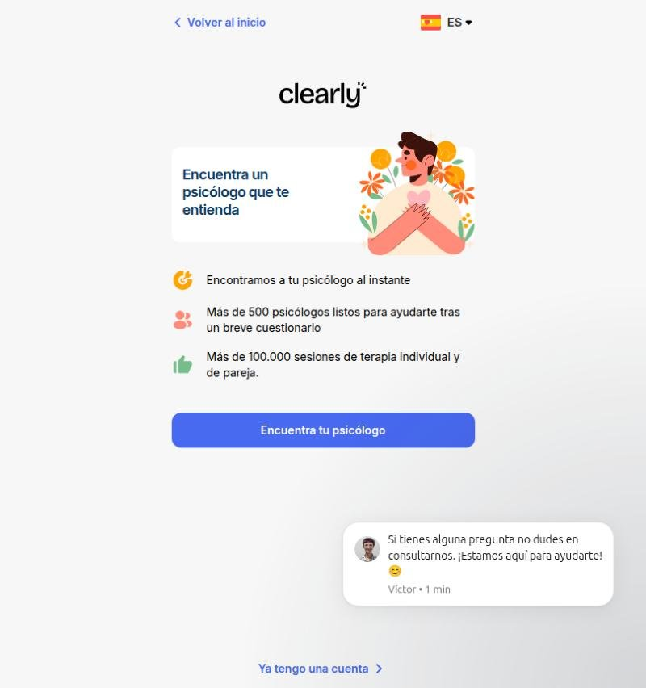
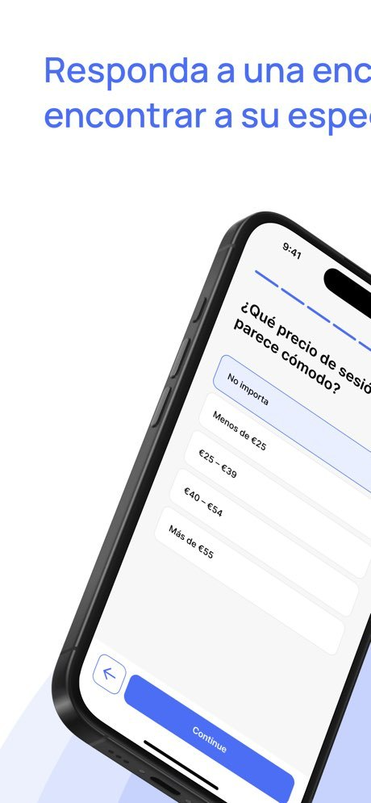
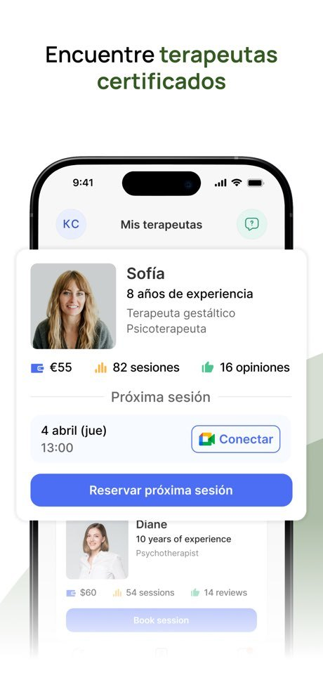
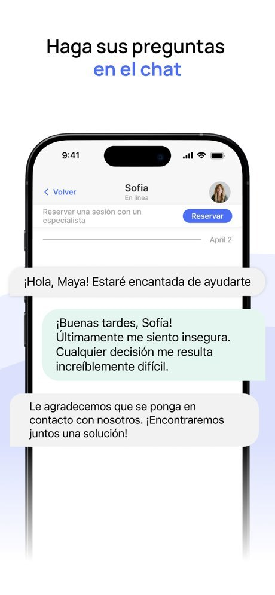
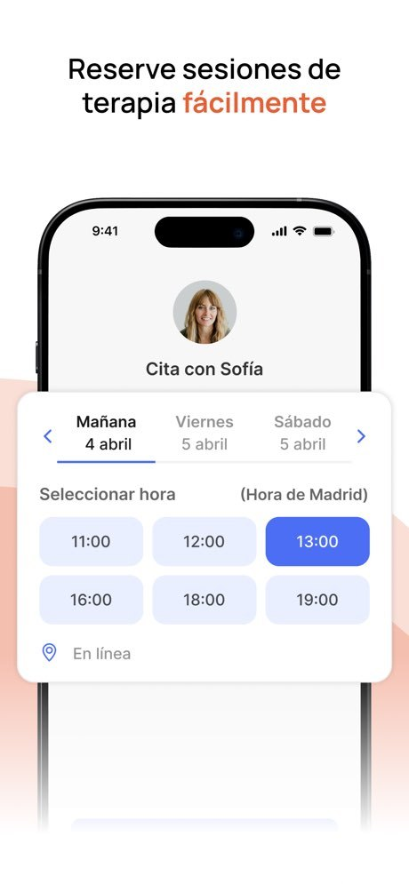
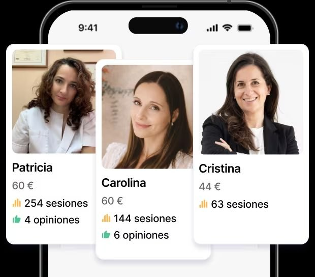
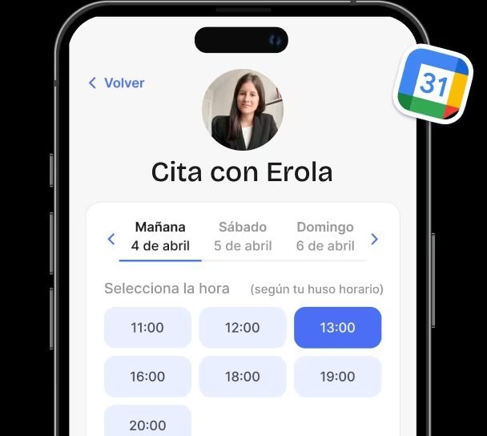
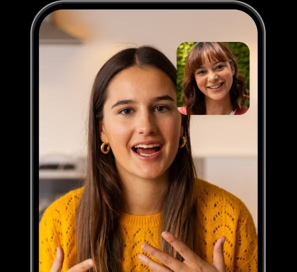

# Benchmark · Clearly: la pantalla principal del paciente

> **Investigado:** 4 de noviembre de 2026
> **Producto:** [Clearly](https://www.clearly.help/es), de Therapy Space Inc. (Delaware, EE. UU.). Es el mismo grupo que hace **Rozmova**, una plataforma ucraniana de psicología online. Tiene app para iOS y Android y un área web ([app.clearly.help](https://app.clearly.help/)), con versiones en inglés y castellano.
> **Cómo se hizo:** no tenemos una cuenta en Clearly, así que no vimos la app por dentro con sesiones reales. El análisis se basa en las capturas oficiales de la App Store (España), en las maquetas de la landing en castellano, en la pantalla de inicio pública del área web, en las preguntas frecuentes y en las reseñas de la App Store, Google Play y Trustpilot. Cuando algo es una inferencia nuestra, lo aclaramos.

---

## 1. Contexto del producto

- **Mercado:** principalmente España (los horarios se muestran en "Hora de Madrid", cobra en euros y las reseñas son de usuarios españoles), con presencia en el Reino Unido e Irlanda (sus recursos de emergencia son de esos países).
- **Modelo:** la plataforma es gratuita para el paciente y **cada profesional pone su precio** (de 20 a 100 € por una sesión de 50 minutos). Hay que pagar **al menos 24 horas antes** con un enlace que llega por el chat. Ofrece tarjeta regalo y cambio de profesional sin costo.
- **Tamaño:** dice tener más de 1.000 psicólogos colegiados y más de 240.000 sesiones. Es más chica que Mindly: tiene 1K+ descargas en Google Play y 238 valoraciones en la App Store de España.
- **Videollamada:** no tiene una propia. Usa **Google Meet**, con un evento automático en Google Calendar, y acepta Zoom o Teams si se acuerda con el terapeuta.

---

## 2. Resumen

- **La pantalla principal se titula "Mis terapeutas".** Es una lista de tarjetas, una por cada profesional con el que el paciente tiene relación. Cada tarjeta reúne a la persona (foto, nombre, experiencia, enfoque), los datos para confiar (precio, sesiones hechas, opiniones), **la próxima sesión con el botón "Conectar"** y el botón "Reservar próxima sesión".
- **El eje es la relación con el profesional, en plural.** A diferencia de BetterHelp (un terapeuta y su conversación) y de Mindly (una agenda), Clearly organiza el inicio por **personas**: cada terapeuta es un bloque con su próxima sesión adentro. Así se puede estar hablando con varios antes de decidir, que es lo que promueve su chat previo a la reserva.
- **Tiene pocos componentes, unos cuatro:** un encabezado con las iniciales del usuario, el título y un acceso al chat de ayuda; la tarjeta de cada terapeuta (que es el componente principal y se repite); dentro de ella, la próxima sesión; y la navegación inferior, que en las capturas aparece desvanecida.
- **El tono es amable, pero el tratamiento no es parejo.** La App Store habla de usted ("Encuentre terapeutas certificados", "Haga sus preguntas en el chat"), mientras que la web y el área de clientes tutean ("Encuentra un psicólogo que te entienda"). Los textos de la interfaz son claros y cortos.

---

## 3. Estructura general

**Hay dos caminos de entrada:**

1. **Persona nueva:** el área web abre en un cuestionario (`app.clearly.help/form`). La pantalla muestra una ilustración de una persona abrazándose, el título "Encuentra un psicólogo que te entienda", tres datos con íconos ("Encontramos a tu psicólogo al instante", "Más de 500 psicólogos listos para ayudarte tras un breve cuestionario", "Más de 100.000 sesiones de terapia individual y de pareja"), el botón "Encuentra tu psicólogo" y un enlace de texto, "Ya tengo una cuenta". Además, aparece un mensaje de bienvenida del soporte firmado por una persona: "Si tienes alguna pregunta no dudes en consultarnos. ¡Estamos aquí para ayudarte! 😊 — Víctor".
2. **Paciente con cuenta:** "Mis terapeutas", la pantalla principal de la app.

El cuestionario termina en **4 especialistas sugeridos**, según las preguntas frecuentes, aunque también se puede recorrer la lista completa. Una de las preguntas es **"¿Qué precio de sesión le parece cómodo?"**, con rangos (No importa, Menos de 25 €, 25–39 €, 40–54 €, Más de 55 €). El presupuesto se pregunta de entrada.

**La navegación inferior** aparece desvanecida en las capturas de la tienda, así que no se pueden leer sus destinos. *Inferencia:* por el encabezado (el acceso al chat de ayuda) y por las funciones descritas, incluye al menos los terapeutas, el chat y la cuenta. Queda como dato pendiente.

| | |
|---|---|
|  |  |
| *Área web para personas nuevas: el cuestionario como puerta de entrada (captura propia, noviembre de 2026).* | *App Store: "¿Qué precio de sesión le parece cómodo?", con rangos.* |

---

## 4. La pantalla principal: "Mis terapeutas"

*App Store (España): "Mis terapeutas", con la tarjeta de Sofía y la próxima sesión. Debajo se ve la tarjeta de una segunda terapeuta.*

### 4.1 Componentes, de arriba hacia abajo

| # | Componente | Qué muestra | Comentario |
|---|---|---|---|
| 1 | **Encabezado** | A la izquierda, un círculo con las iniciales del usuario ("KC"), que lleva a la cuenta. En el centro, el título "Mis terapeutas". A la derecha, un ícono de globo de diálogo con un signo de pregunta, sobre fondo verde: el acceso al **chat de ayuda** | La ayuda está siempre a un toque, arriba a la derecha. Es coherente con su promesa de atención "24 horas al día, 7 días a la semana". |
| 2 | **Tarjeta del terapeuta** (se repite por cada uno) | Una foto grande, el nombre ("Sofía"), los años de experiencia ("8 años de experiencia"), el enfoque y el título ("Terapeuta gestáltico · Psicoterapeuta"), y una fila de tres datos con ícono: **precio** ("55 €"), **sesiones hechas** ("82 sesiones") y **opiniones** ("16 opiniones") | La tarjeta lleva el mismo formato que en el catálogo: el profesional se sigue presentando aunque ya sea "tuyo". El precio queda visible, lo que da transparencia, pero también recuerda el costo en cada visita. |
| 3 | **Bloque "Próxima sesión"** (dentro de la tarjeta) | Un separador con el título "Próxima sesión", la fecha y la hora ("4 abril (jue) · 13:00") y un botón de contorno con el logo de Google Meet: **"Conectar"** | Entrar a la sesión es una acción **secundaria** (contorno), con menos peso que reservar la siguiente. |
| 4 | **Botón "Reservar próxima sesión"** | Un botón azul relleno, de ancho completo | **La acción principal de la pantalla es reservar, no entrar.** Esto empuja a sostener la continuidad del proceso. |
| 5 | **Barra de navegación** | Aparece desvanecida en la captura | No se puede leer. |

**En total son unos cuatro componentes estructurales**, con la tarjeta del terapeuta como unidad que se repite. No hay saludo, ni estado del plan, ni registro del ánimo, ni contenido.

### 4.2 Cómo prioriza la información

1. **Con quién:** la foto y el nombre del profesional, en grande.
2. **Por qué confiar:** la experiencia, el enfoque, las sesiones hechas y las opiniones.
3. **Cuánto cuesta:** el precio por sesión.
4. **Cuándo es la próxima:** la fecha y la hora, con "Conectar".
5. **Qué sigue:** "Reservar próxima sesión".

### 4.3 Estados que se ven en las capturas

- **Con una sesión programada:** el bloque "Próxima sesión" con fecha, hora y "Conectar".
- **Con un terapeuta sin sesión programada:** la segunda tarjeta (Diane) aparece sin el bloque de próxima sesión, solo con el botón "Book session". *Inferencia:* es alguien con quien la persona habló o trabajó, pero no tiene nada reservado.
- **Recordatorios:** un evento en Google Calendar al reservar y un aviso **3 horas antes** de la sesión (App Store y preguntas frecuentes).

---

## 5. Las otras pantallas, en relación con la principal

### Chat con el terapeuta

El encabezado muestra "< Volver", el nombre ("Sofia"), el estado **"En línea"** y la foto. Debajo hay una franja fija: **"Reservar una sesión con un especialista"**, con el botón **"Reservar"**. Los mensajes son burbujas: los del profesional en gris y los del paciente en verde claro. Es la vía para **hacer preguntas antes de reservar** y es también por donde llega el enlace de pago.

En la captura de la tienda se ve un mensaje que parece del equipo, mezclado con la conversación: "Le agradecemos que se ponga en contacto con nosotros. ¡Encontraremos juntos una solución!". Esto muestra que la misma interfaz se usa para hablar con el terapeuta y con el soporte.

### Reservar un horario ("Cita con Sofía")

Arriba aparece la foto del profesional y el título **"Cita con Sofía"**. Los días se recorren con flechas y pestañas ("Mañana · 4 abril", "Viernes · 5 abril", "Sábado · 5 abril"), y los horarios se muestran como botones en una cuadrícula. En la App Store se indica **"(Hora de Madrid)"**, y en la maqueta de la landing, **"(según tu huso horario)"**. Abajo se aclara la modalidad con un ícono de ubicación: "En línea".

### Profesionales recomendados

En la maqueta de la landing aparecen tres tarjetas superpuestas, cada una con foto, nombre, precio, sesiones y opiniones ("Patricia · 60 € · 254 sesiones · 4 opiniones").

| | | |
|---|---|---|
|  |  |  |
| *Chat: franja fija "Reservar una sesión con un especialista" y estado "En línea".* | *Cita: días con pestañas, horarios en cuadrícula y "Hora de Madrid".* | *Landing: tres psicólogas recomendadas con precio, sesiones y opiniones.* |

| | |
|---|---|
|  |  |
| *Maqueta de la landing: "Selecciona la hora (según tu huso horario)", con el ícono de Google Calendar.* | *Videollamada (es Google Meet, según las preguntas frecuentes).* |

---

## 6. Tono de voz

| Rasgo | Ejemplos |
|---|---|
| **Promesa de comprensión** | "Encuentra un psicólogo que te entienda", "Encuentra a tu psicólogo online" |
| **Interfaz corta y clara** | "Mis terapeutas", "Próxima sesión", "Conectar", "Reservar próxima sesión", "Cita con Sofía" |
| **Personas visibles, también en el soporte** | Un mensaje de bienvenida firmado ("Víctor • 1 min"), el estado "En línea" del terapeuta y la cita titulada con el nombre del profesional |
| **Garantía que le baja el riesgo a la elección** | "Si el psicólogo que eliges no encaja contigo, te ayudamos a encontrar otro sin coste adicional" |
| **Datos como prueba** | "82 sesiones", "16 opiniones", "+240 mil sesiones de terapia", "2 min para descubrir a los psicólogos con los que mejor conectas" |
| **Preparación concreta para la sesión** (en las preguntas frecuentes) | "Busca un lugar tranquilo…", "Te aconsejamos que desconectes todo tipo de notificaciones…" |
| **Tratamiento inconsistente** | Usted en la App Store ("Encuentre", "Haga sus preguntas", "¿Qué precio de sesión le parece cómodo?") y tú en la web y en la app web ("Encuentra", "te entienda") |

**Conclusión sobre el tono:** es cercano, práctico y orientado a la confianza a través de las personas (fotos grandes, nombres propios, soporte con firma). La interfaz no tiene textos de acompañamiento en el momento previo a la sesión, porque eso vive en las preguntas frecuentes. La mezcla de usted y tú es un descuido que resta coherencia.

**Lo visual:** el azul es el color de acción, y el verde suave se usa para el soporte y para los mensajes del paciente. Hay íconos chicos de colores para los datos (una billetera para el precio, barras amarillas para las sesiones y un pulgar verde para las opiniones), tarjetas blancas con sombra suave y una ilustración cálida en la entrada.

### Lo que dicen las reseñas sobre la experiencia

- **A favor:** que la app es fácil de usar, que el emparejamiento con el terapeuta funciona y que sirven los **resúmenes de cada sesión hechos con IA** (Trustpilot).
- **En contra:** **falta de claridad en los cobros**. Una reseña cuenta que reservó "una sesión" y le cobraron semanalmente, y la empresa respondió que va a mejorar cómo comunica las reservas y los cobros (Trustpilot). En la App Store hay quejas por "La plataforma no detalla de forma clara las tarifas ni el funcionamiento de los cobros mensuales" y por un código de descuento que no aparecía.

---

## 7. Comparación con BetterHelp, Mindly y nuestro mockup del Inicio

| Tema | Clearly | Mindly | BetterHelp | Mockup de MotivarCare | Para pensar |
|---|---|---|---|---|---|
| **Eje de la pantalla principal** | Los terapeutas ("Mis terapeutas") | La agenda ("Mis sesiones") | El vínculo con un terapeuta (la conversación) | El próximo paso del paciente | Clearly confirma que poner al profesional en primer plano funciona. En nuestro Inicio, la profesional aparece dentro de la tarjeta de la sesión: es un buen equilibrio. |
| **Acción principal** | **Reservar la próxima sesión** (relleno); "Conectar" queda en contorno | "Unirse a la sesión" | "Join video session" | "Entrar a la sesión" | Cuando la sesión está por empezar, entrar debe ser lo principal (como hacemos nosotros). La idea de Clearly sirve para **después** de la sesión: proponer la siguiente. |
| **Precio en la pantalla principal** | Sí, en cada tarjeta ("55 €") | No (sí en el catálogo) | No | "3 sesiones disponibles" | Mostrar el saldo de sesiones es más útil y menos invasivo que repetir el precio. |
| **Datos de confianza** | Sesiones hechas, opiniones y años de experiencia | Opiniones, insignias y demanda | Credenciales (en la web) | Nombre y "Psicóloga clínica" | Podríamos sumar un dato verificable en la ficha (matrícula verificada, años de experiencia), no en el Inicio. |
| **Ayuda** | Un ícono de chat de ayuda fijo arriba a la derecha y un mensaje de bienvenida firmado | En More o en el perfil | En More | Maca abajo a la derecha (punteado) y líneas de apoyo en la barra lateral | Coincide en la idea de "ayuda siempre a mano". En Clearly la ayuda es humana y lleva nombre; en nosotros, Maca es IA con borde punteado. Conviene diferenciar bien la **ayuda técnica** de la **contención**. |
| **Zona horaria** | "Hora de Madrid" o "según tu huso horario" | "según tu zona horaria actual" | "PST" | "hora de Argentina" | Los cuatro la explicitan, así que es un estándar del rubro. |
| **Chat previo a la reserva** | Sí, es central para elegir | Sí | No (asignación automática) | Pendiente de definición | Clearly y Mindly lo usan como herramienta de **decisión**. Es un argumento para la decisión pendiente del README. |
| **Recordatorio** | 3 h antes y evento en Google Calendar | 24 h, 1 h y 15 min | SMS y correo | No está definido | El evento de calendario es muy útil, pero cuidando que el título sea discreto. |
| **Saludo y autocuidado** | No tiene | No tiene | Wellness, aparte | "Hola, Gastón" y "¿Cómo estás hoy?" | Seguimos siendo los únicos que acompañan entre sesiones desde el Inicio. |
| **Tratamiento** | Usted y tú mezclados | Tú, con rasgos de España | Inglés, segunda persona | Voseo en todo | Nuestro criterio de un solo tratamiento queda validado por el contraejemplo. |

### Ideas que surgen de esta investigación

1. **Proponer la siguiente sesión al terminar la actual.** Después de una sesión, el Inicio podría mostrar "Reservá tu próxima sesión con la Lic. Quiroga" como acción principal. Es el patrón de Clearly, aplicado en el momento justo.
2. **Darle cara a la ayuda humana.** Un mensaje de bienvenida firmado por alguien del equipo (en lugar de un "Soporte" genérico) genera cercanía. Hay que mantenerlo separado de Maca.
3. **Ser claros con el dinero siempre.** La principal queja contra Clearly son los cobros poco claros. Confirma la decisión del mockup de mostrar "el monto exacto que vas a ver en el pago" (caso 04, H1).
4. **Preguntar el presupuesto en el emparejamiento.** La pregunta "¿Qué precio de sesión te parece cómodo?", con rangos, es directa y evita sugerir profesionales que la persona no puede pagar.
5. **Llevar la preparación de la sesión a la interfaz.** Clearly tiene buenos consejos ("Busca un lugar tranquilo", "desconecta las notificaciones"), pero escondidos en las preguntas frecuentes. Nosotros podemos mostrar uno en la tarjeta de la sesión, junto a "Probar cámara".
6. **Prever más de un profesional.** El modelo de tarjetas por terapeuta es una referencia por si un paciente trabaja con dos profesionales (por ejemplo, terapia individual y de pareja) o si está eligiendo entre varios.

---

## 8. Límites de esta investigación

- No vimos la app con una cuenta real. "Mis terapeutas" sale de una captura oficial de la tienda con datos ficticios ("Sofía", "Diane").
- La barra de navegación aparece desvanecida en todas las capturas, así que no conocemos sus destinos.
- En el área web no avanzamos más allá de la pantalla inicial del cuestionario. Rechazamos las cookies no esenciales.
- Las imágenes de la App Store y de la landing pertenecen a Clearly. La pantalla del área web es una captura propia de una página pública. Como el repositorio es público, **conviene decidir antes del push si las imágenes se suben** (el mismo criterio que con BetterHelp y Mindly).

---

## Fuentes

- [Clearly, landing en castellano](https://www.clearly.help/es): propuesta, preguntas frecuentes, pagos, Google Meet y las maquetas 06, 07 y 08
- [Clearly, landing en inglés](https://www.clearly.help/): mercado, precios y garantías
- [Clearly: psicólogo online, App Store (España)](https://apps.apple.com/es/app/clearly-psic%C3%B3logo-online/id6502760495): capturas 01 a 05, descripción y reseñas
- [Clearly, Google Play](https://play.google.com/store/apps/details?id=help.clearly.app&hl=en_US): desarrollador, valoración y descargas
- [Clearly, Trustpilot](https://www.trustpilot.com/review/clearly.help): reseñas sobre la experiencia y los cobros
- [Clearly, área web para clientes](https://app.clearly.help/): captura 09 (entrada al cuestionario)
