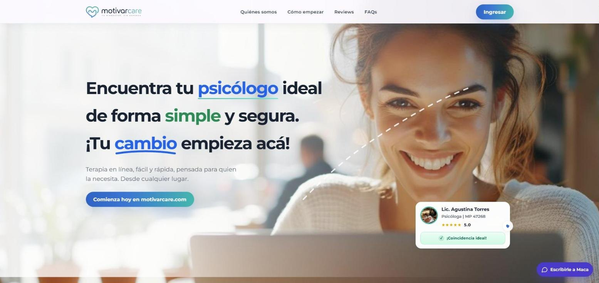
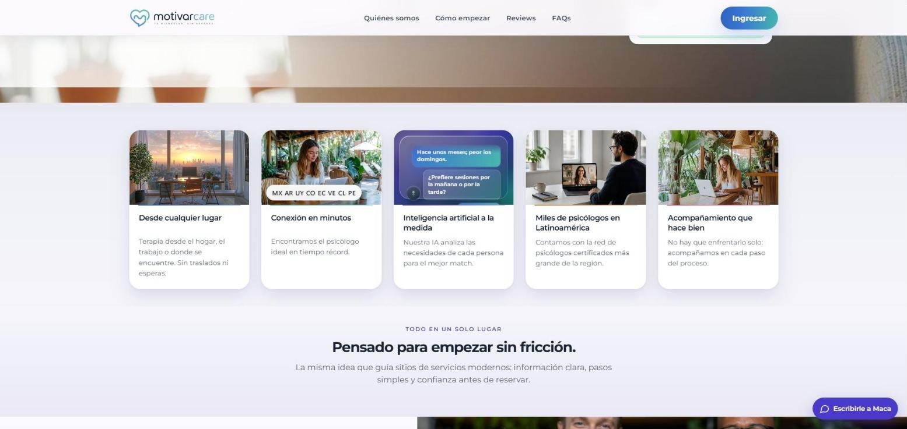
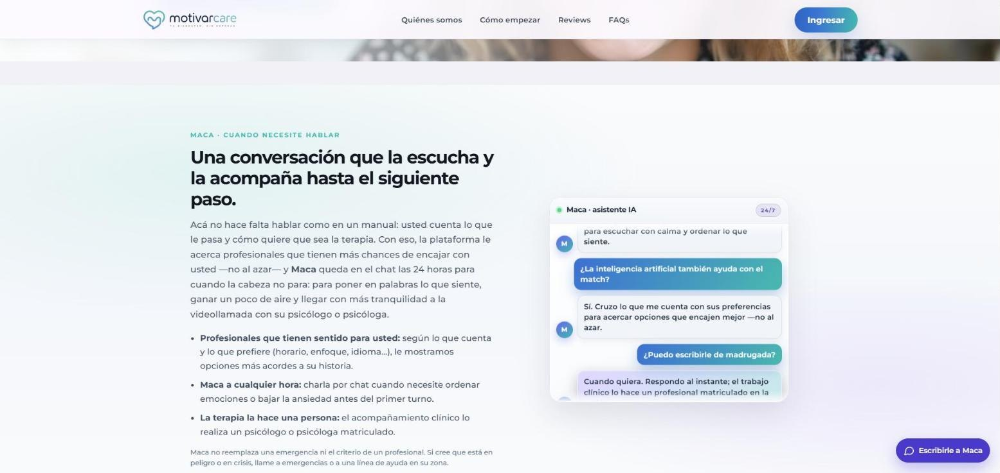

# 08 · Landing page

Contenidos de la landing page pública de MotivarCare ([www.motivarcare.com](https://www.motivarcare.com/)).

## Propuesta nueva

Primera versión de una landing renovada, armada con el design system de MotivarCare (`04-design-system`). Usa los contenidos actuales con ajustes chicos, suma algunas secciones y deja indicado con **PLACEHOLDER** el lugar de cada imagen.

- **Dónde está:** `web/public/landing/`. Se ve en el portal en `/landing/index.html`.
- **Cómo está armada:** HTML, CSS y JavaScript separados (`index.html`, `css/estilos.css`, `js/main.js`), con las fuentes y el logo dentro de la misma carpeta. No depende del portal: la carpeta `landing/` se puede copiar tal cual y publicar como un sitio independiente.
- **Indexación:** tiene `noindex` mientras sea una propuesta.

### Criterios

1. **Credibilidad antes que promesa.** Se moderan las afirmaciones que no se pueden respaldar ("miles de psicólogos", "la red más grande de la región", "tiempo récord") y se reemplazan por datos verificables del servicio: matrícula verificada, sesiones de 50 minutos, precio de referencia, sin suscripción.
2. **Hablarle a quien busca ayuda, no a "un usuario".** Se agrega una sección sobre los motivos de consulta del día a día y la primera vez en terapia, con un tono que invita y no asusta, y se sacan los textos que sonaban internos o genéricos ("la misma idea que guía sitios de servicios modernos").
3. **Lo humano primero; la IA, en su lugar.** La IA se menciona solo en la sección de Maca, para que no parezca un sitio donde la terapia la hace una IA. Ahí, la terapia (sólido) y Maca (punteado) se presentan como dos territorios con un límite claro, siguiendo el principio "sólido = humano; punteado = IA".
4. **Seguridad sin alarmar.** La información sobre crisis no se destaca en la entrada de la página, para no ahuyentar a quien recién se acerca. Queda donde corresponde: en el aviso de Maca, en una pregunta frecuente y en el pie (líneas de apoyo). Más adelante en el flujo, dentro de la app, puede tener más presencia.
5. **Un solo tratamiento: voseo.** Se unifica "tú", "usted" y voseo en un voseo rioplatense amable ("Encontrá", "Contanos", "Reservá").
6. **Calma visual.** Fondo crema, secciones alternadas en menta, un solo acento amarillo por bloque, una animación principal por pantalla y nada de emojis (las banderas pasan a ser chips con el nombre del país). Con "reducir movimiento" no hay animaciones.

### Cambios por sección

| Sección | Qué cambia |
|---|---|
| Encabezado | Se reordena la navegación (Cómo funciona, Profesionales, Maca, Precios, Preguntas) y se suma el acceso "Soy profesional". |
| Hero | Mismo mensaje, en voseo, con "ideal" destacado. Se agregan un segundo botón ("Cómo funciona") y tres garantías concretas debajo. La tarjeta de perfil muestra a la Lic. Agustina Torres, sin número de matrícula. La composición de videollamada sobre el corazón tiene una foto de la profesional y una del paciente, con el tratamiento de color de la marca; la ventana de la profesional tiene un marco punteado y la del paciente, un poco más grande, lleva el ícono amarillo del micrófono, como en la portada del deck. |
| **Para quién es** (nueva) | "La terapia también es para lo que te pasa en el día a día." Un texto que invita a empezar sin tener todo claro y una caja con temas frecuentes de consulta (ansiedad, dormir mal, duelo, vínculos, primera vez en terapia, etc.). |
| Por qué MotivarCare | Cuatro razones, con textos moderados: desde donde estés, conexión en minutos, profesionales de toda la región y acompañamiento. Se quita la tarjeta de inteligencia artificial (la IA queda solo en la sección de Maca). Toma el título "Pensado para empezar sin fricción", que antes estaba en un bloque aparte. "Desde donde estés" pasa a ser la bajada del título y su lugar lo ocupa una ilustración en primera persona: un teléfono en una plaza que recibe la notificación "Sesión en 5 minutos" y muestra el botón "Iniciar sesión". Las manchas del sol, de los árboles y de detrás del teléfono cambian de forma en loop, los pájaros aletean y unos puntitos vuelan como abejas. "Conexión en minutos" queda a la derecha, más angosta. El chat de ejemplo queda en voseo y se anima mensaje por mensaje. Se quitan las banderas de países. |
| Psicólogos certificados | Pasa a explicar **cómo** se verifica: cada profesional carga matrícula, título y experiencia, y el equipo los revisa antes de publicar el perfil. Se acompaña con una ficha de revisión con la foto, el nombre y la especialidad de un profesional ficticio (Lic. Diego Ferreyra, psicólogo clínico, terapia cognitivo-conductual). |
| Cómo empezar | Los mismos cuatro pasos, en voseo, con un botón "Crear mi cuenta" al final. |
| Maca | Se agrega el bloque de los dos territorios (la terapia y el apoyo). El texto, los beneficios, el aviso y el chat se mantienen, en voseo. La ventana de Maca va con borde punteado. El ícono de Maca (mujer con auricular, en línea orgánica) aparece en la tarjeta "El apoyo" y en el encabezado del chat. |
| Quiénes somos | Se corrige "Maca impulsó MotivarCare" (Maca es la IA, no la fundadora) por "MotivarCare nació en Argentina…". Se dejan placeholders para la foto del equipo y para un texto sobre quiénes lo integran. |
| Precios | Mismo contenido, en una tarjeta de precio y una lista de "Lo que tenés que saber". |
| Reseñas | Se muestran todas juntas en una grilla en lugar de un carrusel, sin editar, con la aclaración "Reseñas publicadas por pacientes en la plataforma, sin editar". Cada una lleva la foto de perfil del sitio actual, con el tratamiento de color de la marca para unificarlas (`landing/img/resenas/`). Se saca el "hace 163 días". |
| Preguntas frecuentes | Las seis en voseo, más dos nuevas: "¿Los profesionales tienen matrícula?" y "¿Qué hago si estoy en crisis?" (sin destacar, al final de la lista). |
| **Para profesionales** (nueva) | "¿Sos psicólogo o psicóloga?", con los tres pasos para sumarse y un botón al portal de profesionales. |
| **Cierre** (nueva) | Banda verde bosque en dos columnas: a la izquierda "Tu cambio empieza acá.", un texto corto y los botones "Empezá hoy" y "Tengo dudas"; a la derecha, sobre el corazón, la misma foto de la escena de cierre que usa el deck. |
| Pie | Mismos enlaces, ordenados en columnas (portales e información). |
| Botón flotante | "Escribile a Maca", con borde punteado y el ícono de Maca. |

### Placeholders pendientes

- Quiénes somos: foto o retratos del equipo, y un texto sobre quiénes lo integran y qué profesionales asesoran a MotivarCare.

### A confirmar con el equipo

- Que la revisión de matrícula, título y experiencia antes de publicar un perfil se describa como en la propuesta.
- La lista de países donde se ofrece el servicio.
- Los perfiles del hero (Lic. Agustina Torres) y de la ficha de revisión (Lic. Diego Ferreyra), y sus fotos, son ficticios: las fotos se generaron con Figma AI. Antes de publicar, decidir si se reemplazan por un perfil y fotos reales (con autorización) o si se aclara que es una ilustración.
- Si las reseñas pueden mostrarse con nombre y foto. Algunas fotos del sitio actual parecen de banco de imágenes o generadas; si no son de los pacientes reales, conviene reemplazarlas por fotos reales (con autorización) o por iniciales, porque una foto genérica junto a un testimonio resta credibilidad.

## Versión actual en producción

Relevada el 15 de octubre de 2026. Es el texto tal como aparece en el sitio, en el orden de la página y con su jerarquía. Los textos van entre comillas de bloque para distinguirlos de las notas. Las capturas muestran las tres partes más representativas de la página en escritorio.

### Metadatos

- **Título de la página:** MotivarCare — Terapia en línea, sin esperas
- **Descripción:** Encuentre al psicólogo ideal en minutos. Terapia en línea en Latinoamérica. Bienestar, sin esperas.

### Encabezado y navegación

- Quiénes somos → `#quienes-somos`
- Cómo empezar → `#como-empezar`
- Reviews → `#reviews`
- FAQs → `#faq`
- **Ingresar** → app.motivarcare.com

### 1. Hero

> **H1:** Encuentra tu psicólogo ideal / de forma simple y segura. / ¡Tu cambio empieza acá!
>
> Terapia en línea, fácil y rápida, pensada para quien la necesita. Desde cualquier lugar.
>
> **Botón:** Comienza hoy en motivarcare.com → app.motivarcare.com

Tarjeta flotante de ejemplo (perfil de profesional):

> Lic. Agustina Torres · Psicóloga | MP 47268 · ★★★★★ 5.0 · ✓ ¡Coincidencia ideal!

### 2. Por qué MotivarCare

> **H2:** Por qué MotivarCare

Cinco tarjetas:

1. **Desde cualquier lugar.** Terapia desde el hogar, el trabajo o donde se encuentre. Sin traslados ni esperas.
   - Banderas: México, Argentina, Uruguay, Colombia, Ecuador, Venezuela, Chile y Perú.
2. **Conexión en minutos.** Encontramos el psicólogo ideal en tiempo récord.
   - Chat animado de ejemplo:
     > — ¿Me ayuda a encontrar un psicólogo?
     > — Claro. ¿Qué le gustaría trabajar en terapia?
     > — Ansiedad y que no duermo bien.
     > — ¿Desde cuándo se siente así?
     > — Hace unos meses; peor los domingos.
     > — ¿Prefiere sesiones por la mañana o por la tarde?
     > — Por la tarde.
     > — Gracias — ya estoy buscando la mejor coincidencia para usted.
3. **Inteligencia artificial a la medida.** Nuestra IA analiza las necesidades de cada persona para el mejor match.
4. **Miles de psicólogos en Latinoamérica.** Contamos con la red de psicólogos certificados más grande de la región.
5. **Acompañamiento que hace bien.** No hay que enfrentarlo solo: acompañamos en cada paso del proceso.

### 3. Todo en un solo lugar

> **Etiqueta:** Todo en un solo lugar
>
> **H2:** Pensado para empezar sin fricción.
>
> La misma idea que guía sitios de servicios modernos: información clara, pasos simples y confianza antes de reservar.

#### Psicólogos certificados

> **H3:** Psicólogos certificados
>
> Profesionales especializados dedicados a tu bienestar mental y emocional.

- Formación académica verificada
- Experiencia comprobada
- Compromiso con tu bienestar

### 4. Cómo empezar (`#como-empezar`)

> **H2:** Cuatro pasos para empezar
>
> Del registro a la primera sesión, sin complicaciones.

1. **Registro.** Cree la cuenta en el portal en minutos con el correo electrónico.
2. **Cuéntenos lo que necesita.** Complete el informe o converse con nuestra IA para acotar lo que busca.
3. **Conozca el match.** Mostramos profesionales acordes al perfil y las preferencias.
4. **Reserve y comience.** Elija horario y comience sesiones en línea cuando le convenga.

### 5. Quiénes somos (`#quienes-somos`)

> **Etiqueta:** MotivarCare
>
> **H2:** ¿Quiénes somos?
>
> Terapia que se adapta al ritmo de cada persona — no al contrario.
>
> Maca impulsó MotivarCare con una idea clara: que pedir ayuda psicológica sea sencillo. Nacimos para acercar un acompañamiento psicológico serio y humano: claro, accesible y pensado para el día a día.
>
> **Botón:** Comienza hoy en motivarcare.com → app.motivarcare.com

### 6. Maca, asistente de IA (`#maca-ia`)

> **Etiqueta:** Maca · cuando necesite hablar
>
> **H2:** Una conversación que la escucha y la acompaña hasta el siguiente paso.
>
> Acá no hace falta hablar como en un manual: usted cuenta lo que le pasa y cómo quiere que sea la terapia. Con eso, la plataforma le acerca profesionales que tienen más chances de encajar con usted —no al azar— y Maca queda en el chat las 24 horas para cuando la cabeza no para: para poner en palabras lo que siente, ganar un poco de aire y llegar con más tranquilidad a la videollamada con su psicólogo o psicóloga.

- **Profesionales que tienen sentido para usted:** según lo que cuenta y lo que prefiere (horario, enfoque, idioma…), le mostramos opciones más acordes a su historia.
- **Maca a cualquier hora:** charla por chat cuando necesite ordenar emociones o bajar la ansiedad antes del primer turno.
- **La terapia la hace una persona:** el acompañamiento clínico lo realiza un psicólogo o psicóloga matriculado.

> Maca no reemplaza una emergencia ni el criterio de un profesional. Si cree que está en peligro o en crisis, llame a emergencias o a una línea de ayuda en su zona.

Chat de ejemplo (encabezado "Maca · asistente IA · 24/7"):

> — Necesito ayuda para elegir psicólogo: no sé por dónde empezar.
> — **Maca:** Hola, soy Maca. Estoy disponible las 24 horas para escuchar con calma y ordenar lo que siente.
> — ¿La inteligencia artificial también ayuda con el match?
> — **Maca:** Sí. Cruzo lo que me cuenta con sus preferencias para acercar opciones que encajen mejor —no al azar.
> — ¿Puedo escribirle de madrugada?
> — **Maca:** Cuando quiera. Respondo al instante; el trabajo clínico lo hace un profesional matriculado en la sesión.

### 7. Precios (`#precios`)

> **Etiqueta:** Precios transparentes
>
> **H2:** Sesiones claras y sin sorpresas
>
> Referencia en Argentina: **Desde $40.000 ARS / sesión**
>
> Varía según experiencia y enfoque del profesional.

- 50 minutos por encuentro — tiempo estándar en la plataforma.
- Packs con descuento cuando el profesional los publique (4, 8 o 12 sesiones).
- Sin suscripción obligatoria — paga solo lo que use.

> Cree la cuenta, explore perfiles y reserve la primera sesión con todo claro desde el inicio.
>
> **Botón:** Reservar la primera sesión → app.motivarcare.com

### 8. Reviews (`#reviews`)

> **Etiqueta:** Experiencias
>
> **H2:** Reviews
>
> Lo que dicen quienes ya usaron MotivarCare.

Carrusel con flechas (← →). Todas las reseñas tienen 5 estrellas y la etiqueta "Paciente":

- **Martin** (hace 163 días): "anda bien...gracias Leo, mi psicologo, por ayudarme en un momento de mucha tristeza...y Maca genial!"
- **Ricardo** (hace 166 días): "está bueno. Pude hacer terapia desde mi telefono...facil"
- **Tamara Gloria** (hace 193 días): "Me gusta la idea de tener terapia online con un psicologo, pero aparte tener contención a cualquier horario. Los ejercicios están bien"
- **Nazareno** (hace 169 días): "Me gustó la idea de hacer terapia online. Y no es tan caro"
- **Julieta** (hace 197 días): "Gracias MotivarCare. Me gusta mucho esto de hacer terapia online...no tengo que viajar y lo puedo hacer desde cualquier lado"

### 9. Preguntas frecuentes (`#faq`)

> **Etiqueta:** Dudas comunes
>
> **H2:** Preguntas frecuentes
>
> Respuestas claras antes de la primera sesión. Si necesita algo más específico, escríbanos desde el portal.

- **¿Cómo sé qué psicólogo elegir?** Revise perfiles, años de experiencia y enfoque terapéutico. Si la primera opción no convence, puede ajustar y probar con otro profesional sin complicaciones.
- **¿Las sesiones son confidenciales?** Sí. Son privadas y se rigen por el secreto profesional que corresponde a cada matriculado.
- **¿Qué pasa si no conecto con el profesional?** Puede cambiar de psicólogo cuando lo necesite. La idea es encontrar a alguien con quien se sienta a gusto y le inspire confianza.
- **¿Necesito experiencia previa en terapia?** No. Puede empezar aunque sea la primera vez en un proceso terapéutico.
- **¿Cómo es la sesión en línea?** Videollamada en un entorno seguro de la plataforma. Solo se necesita internet y un lugar tranquilo.
- **¿Puedo elegir horario?** Sí. Puede elegir día y franja según la disponibilidad que cada profesional publica.

### 10. Pie de página

- **Portales:** Portal pacientes → app.motivarcare.com · Portal profesionales → pro.motivarcare.com
- **Legales:** Política de privacidad (`/docs/privacy.html`) · Términos (`/docs/terms.html`) · Líneas de apoyo (`/docs/crisis.html`)
- © 2026 MotivarCare · Argentina · soporte@motivarcare.com
- Marca: motivarcare · BIENESTAR, SIN ESPERAS

### Elementos flotantes

- Botón fijo: **Escribirle a Maca** (abre el chat).

### Observaciones del relevamiento

- **Tratamiento mezclado:** el hero y algunas tarjetas usan "tú" ("Encuentra tu psicólogo", "tu bienestar") y voseo ("¡Tu cambio empieza acá!"), mientras que el resto del sitio usa "usted" ("Cree la cuenta", "Elija horario").
- **"Miles de psicólogos" y "la red más grande de la región"** son afirmaciones que conviene respaldar con datos o moderar.
- Las reseñas se muestran tal como están publicadas, con sus faltas de tildes.
